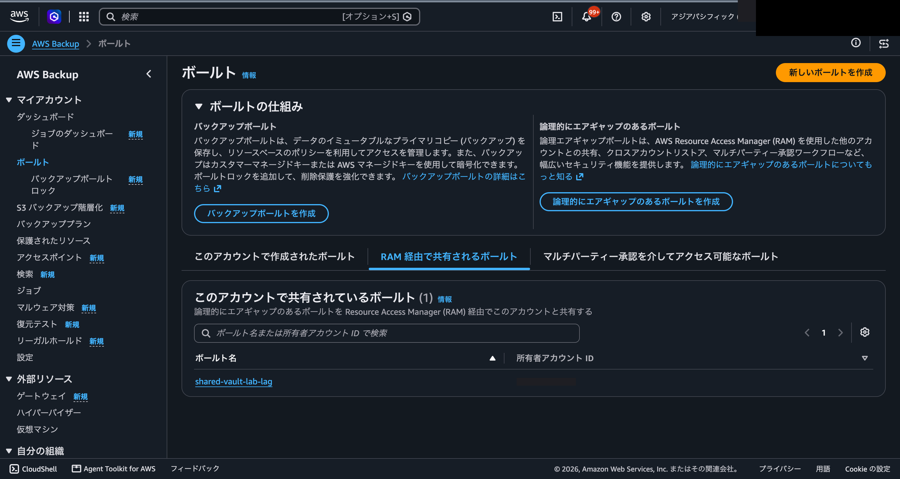
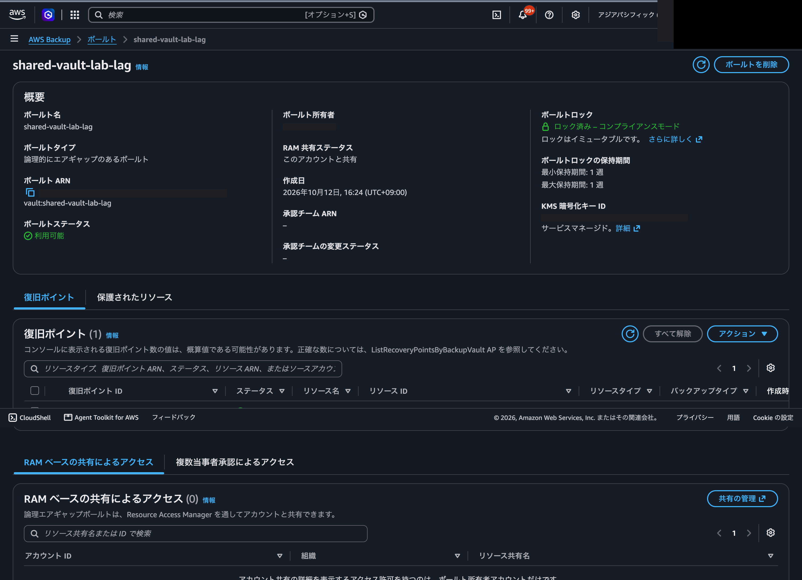
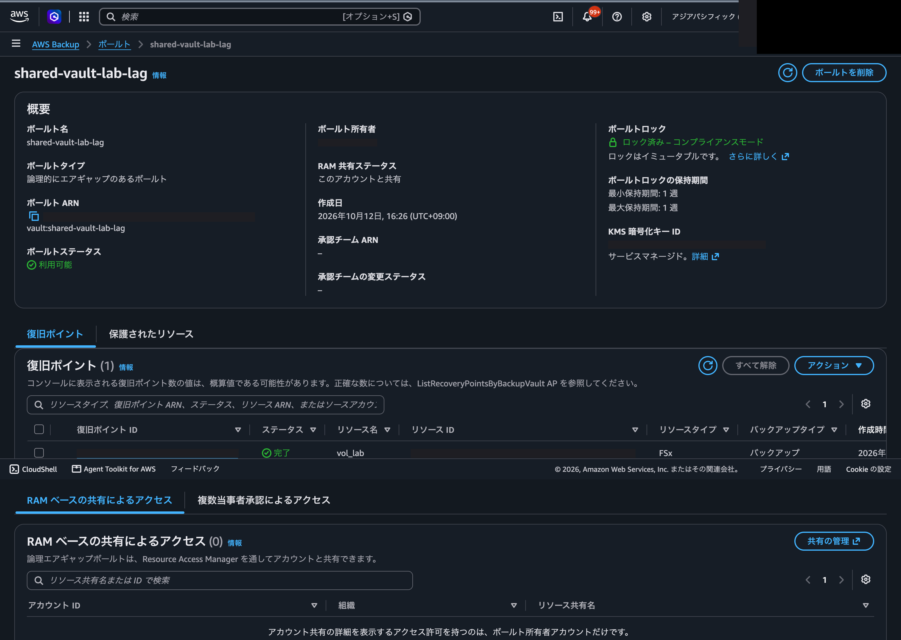
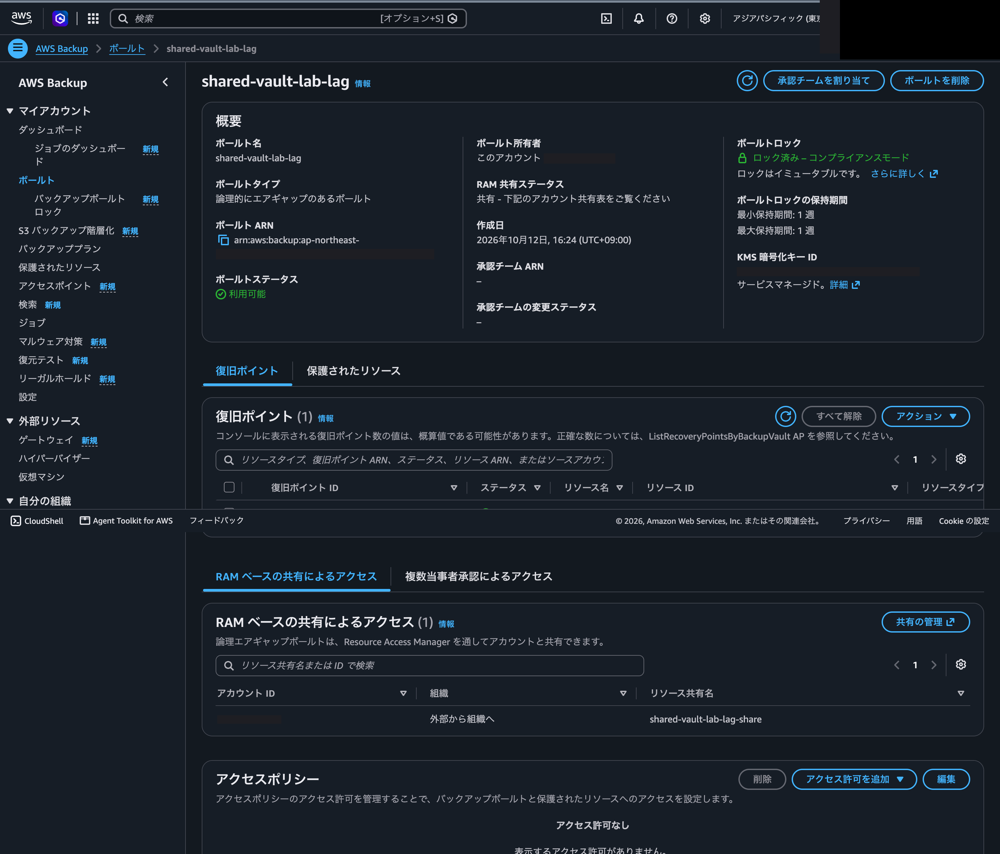
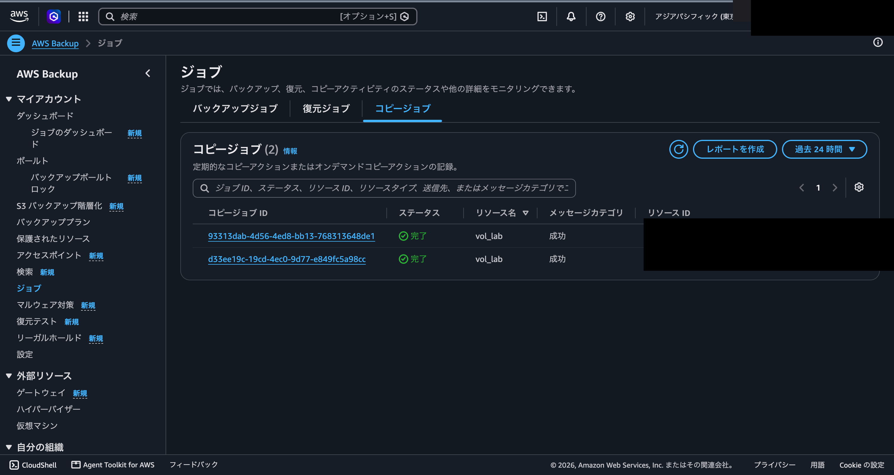
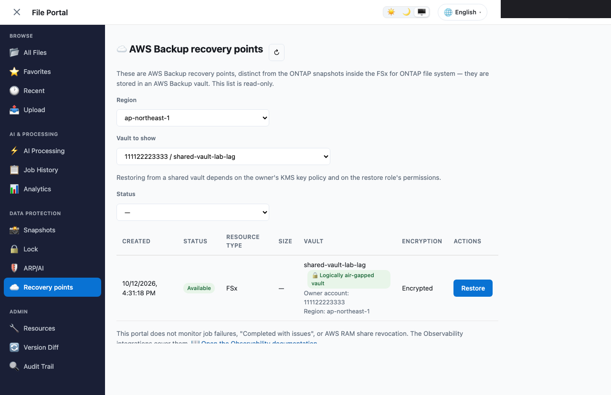
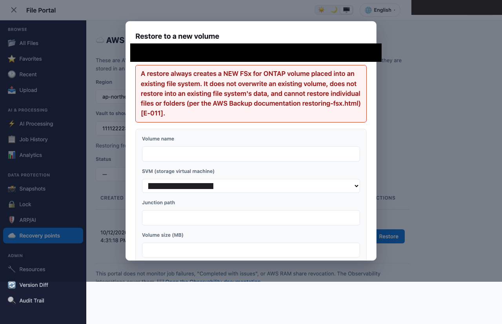
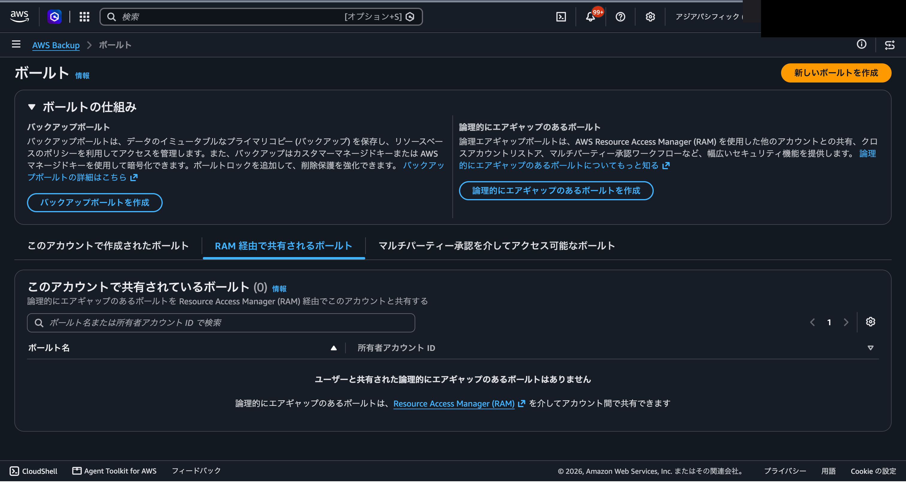
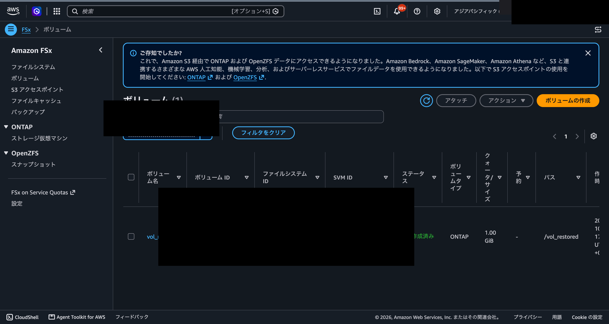

# Real-environment run: recorded [V1][V2][V3][V4][V5][V6][V7]; not recorded [E13] (status source: docs/verification-record.md)

🌐 **Language / 言語**: 日本語 | [English](verification-record.en.md)

> Language / 言語: 日本語 | [English](verification-record.en.md)

この文書は、共有ボールト検証ラボの状態の唯一の出所です。README と手順書の状態の行は、この文書を指します。

## 状態

実機での通しの日付と環境: 2026-10-12（JST）。所有者と受け手の両アカウントを ap-northeast-1 に置き、第 2 リージョンを ap-northeast-3 として、ラボ自身のスクリプトとテンプレートで通しました。下の記録の表に V1〜V7 の結果を 1 行ずつ載せています。E13（組織共有が有効な環境）は、この環境が組織共有を無効にした招待経路のため記録していません。MPA は実行していません（下の「MPA の扱い」）。

状態の行の文法には、全項目が成立するまでの中間状態があります。環境が排他で全項目を同時に満たせないため、成立した項目だけを並べます。

- 成立した記録が 0 件: `# Real-environment run: not yet done (status source: docs/verification-record.md)`
- 一部が成立: `# Real-environment run: recorded [V1][V4]; not recorded [E13] (status source: docs/verification-record.md)`
- `recorded` に並ぶのは現行のコードの digest で成立している項目、`not recorded` は残りです。`recorded` が空のときだけ `not yet done` と書きます。

## 検証項目の定義

公開側の V / E の定義はこの表が正です。README・手順書・06 / 07 の出力に出る番号は、全てここで引けます。`scripts:` の列は、その項目を出すスクリプトの番号です。`07-ui` は 07 の画面確認（`--ui`）のモードを指します。

| 項目 | 内容 | scripts |
|---|---|---|
| V1 | 受け手の `--by-shared` に共有ボールトが 1 件出て、ARN のアカウントが所有者、`VaultType` が LAG であること | scripts: 06 |
| V2 | 所有者の `--by-shared` が空であること（共有の方向の確認） | scripts: 06 |
| V3 | ポータルのロールで、共有ボールトの ARN が無い状態は拒否、足した状態は成功すること（2 段） | scripts: 07, 07-ui |
| V4 | `--backup-vault-account-id` を付けない呼び出しが `AccessDeniedException`、付けた呼び出しが成功すること | scripts: 06 |
| V5 | 配備済みの関数で `listSharedBackupVaults` がエラーなく成功し、画面でも共有ボールトが選べること | scripts: 07, 07-ui |
| V6 | 共有の取り消しから一覧に出なくなるまでの秒数と、その間のエラーコード、画面側の通知 | scripts: 07, 07-ui, 09 |
| V7 | 共有ボールトの復旧ポイントを受け手の SVM に復元できること | scripts: 06, 08 |
| V8 | AWS 管理キーの FS からのバックアップの扱い（否定側）。第 2 の FS が要るため別の判断とします | scripts: MANUAL（直接の API 観測。本ラボのスクリプトは出しません） |
| E1 | `aws cloudformation deploy` が `Rules` の不一致を拒否し、LAG ボールトのスタックが AVAILABLE まで進むこと | scripts: 03 |
| E2 | `AWS::RAM::ResourceShare` の `ResourceArns` / `Principals` で LAG ボールトを共有でき、組織共有が無効な環境で招待が PENDING になること | scripts: 03, 05 |
| E3 | CloudFormation で作った FS・SVM・ボリュームのタグが `fsx list-tags-for-resource` で読めること | scripts: 02 |
| E4 | `BackupRole` のインライン KMS ポリシーで、同一リージョンと別リージョンのコピーが成功すること | scripts: 04 |
| E5 | 別リージョンのコピーの所要時間と、失効日がコピー元の作成時刻 + N 日になること | scripts: 04, 06 |
| E6 | 別リージョンの復旧ポイントを、そのリージョンの受け手 FS に復元できること | scripts: 08 |
| E7 | 失敗したコピージョブを同じ冪等トークンで再試行したときの挙動（新しいジョブか、元のジョブか） | scripts: MANUAL（直接の `start-copy-job` でしか観測できません） |
| E8 | 受け手の専用ロール（Restores の管理ポリシーのみ）で復元が通ること | scripts: 08 |
| E9 | 復元メタデータの読み取りと書き込みのキーの差、ポータル経路が組み立てるメタデータでも通ること | scripts: 08 |
| E10 | LAG へのコピーのジョブに `StatusMessage` が付くかどうか（付けば「Completed with issues」の確認） | scripts: 04 |
| E11 | 共有を `ram delete-resource-share` で消した後の `delete-stack` が通ること | scripts: 10 |
| E12 | CloudFormation のボリューム削除の挙動と、API 削除の後にスタック削除する順序が通ること | scripts: 10 |
| E13 | 組織共有が有効な環境で招待なしにアクセスでき、`AllowExternalPrincipals=false` が通ること | scripts: 03, 05 |
| E14 | SSO トークンの残り分数の計算が、実際のキャッシュと一致すること | scripts: 01 |
| E15 | 価格 API の属性名と、見積もりの行の対応 | scripts: 01 |
| E16 | `describe-type` が、提供されないリージョンで `TypeNotFoundException` を返すこと。`SINGLE_AZ_1` が使えないリージョンで 02 の作成要求がその場で拒否されること | scripts: 01, 02 |
| E17 | `ResourceTypeOptInPreference` の `FSx` が `false` でも、ARN 指定のオンデマンドのバックアップが通ること | scripts: 01, 04 |
| E18 | `iam simulate-principal-policy` が SSO のロールに意味のある結果を返すこと、SCP / RCP が評価に含まれるか | scripts: 01 |
| E19 | 組織共有の状態が所有者のプロファイルから読めること（管理アカウントのとき） | scripts: 01 |
| E20 | Playwright spec が、実際のポータルの画面に対して通ること、`rpRestoreConfirm` が確認の前に無効であること | scripts: 07-ui |
| E21 | `ShareEnabled` の切り替えで、既に無い共有の削除が成功し、新しい共有と招待が作られること | scripts: 03, 05 |
| E22 | `aws cloudformation deploy --parameter-overrides file://…` が例ファイルを受理すること | scripts: MANUAL（直接デプロイの経路で観測。スクリプトは出しません） |
| E23 | CloudFormation の資源の権限の列挙が、実際に必要な権限を過不足なく覆うこと | scripts: MANUAL（権限不足はデプロイの実行でのみ観測。01 のシミュレーションは足りる保証になりません） |
| E24 | 別リージョンのコピージョブが、どのリージョンの `list-copy-jobs` に出るか（送信元、宛先、両方） | scripts: MANUAL（直接の `list-copy-jobs` の観測。04 / 10 は両方を読みますが、どちらに出るかは出力しません） |
| E25 | 07 `--ui` の起動経路が実機で働くこと（dev サーバーの起動、chromium の導入判定、レポートの読み取り） | scripts: 07-ui |
| E26 | `ce get-cost-and-usage` が `Project` タグのフィルタで値を返すこと、タグの付かない費用の扱い | scripts: 06 |

## 実機の記録

1 行 = 1 回の実行における 1 項目の結果です。行は 1 回の実行の結果であり、他の環境や規模への一般化ではありません。行は `python3 scripts/lib/lab_helpers.py record-row` が `lab-run.local.jsonl` から候補を印字し、アカウント ID と ARN をマスクして人が貼ります。自動では書きません。

項目は上の定義表の閉じた集合に含まれ、`結果` は `N✅ N❌ N⚠` の形で、`❌` が 0 かつ `✅` が 1 以上のとき、その項目を主張の根拠に使えます。`コードの digest` は 12 桁の 16 進で、現行のコードの digest と一致する行だけが成立します。`portal-ref` は V3・V5・V6・V7 の行で埋め、他は `-` です。

| 実施日（UTC） | リージョン | 構成 | AWS CLI | コードの digest | portal-ref | 項目 | 結果 | 所要 | 備考 |
|---|---|---|---|---|---|---|---|---|---|
| 2026-10-12 | ap-northeast-1 | SINGLE_AZ_1 128MBps 1024GiB | aws-cli/2.36.5 | b8ec32a85b54 | - | V1 | 1✅ 0❌ 0⚠ | 18s | script 06_verify.sh。両リージョンで PASS。`--by-shared` に LAG 1 件、ARN は所有者、VaultType LOGICALLY_AIR_GAPPED_BACKUP_VAULT、by-shared 行では VaultState 無し・NumberOfRecoveryPoints 0 |
| 2026-10-12 | ap-northeast-1 | SINGLE_AZ_1 128MBps 1024GiB | aws-cli/2.36.5 | b8ec32a85b54 | - | V2 | 1✅ 0❌ 0⚠ | 18s | script 06_verify.sh。両リージョンで所有者の `--by-shared` は空 |
| 2026-10-12 | ap-northeast-1 | SINGLE_AZ_1 128MBps 1024GiB | aws-cli/2.36.5 | b8ec32a85b54 | - | V4 | 1✅ 0❌ 0⚠ | 18s | script 06_verify.sh。`--backup-vault-account-id` 無しは AccessDeniedException、付けると成功し復旧ポイント 1 件。ARN 形 arn:aws:backup:<region>:<owner>:recovery-point:<id> |
| 2026-10-12 | ap-northeast-1 | SINGLE_AZ_1 128MBps 1024GiB | aws-cli/2.36.5 | b8ec32a85b54 | f0eac3fbaffd | V3 | 1✅ 0❌ 0⚠ | 41s | script 07_portal_config.sh（--ui, arn-present）。ロールのポリシーに共有ボールト ARN、spec の arn-present 2 件が PASS（エアギャップのチップ・所有者アカウント表示、復元ダイアログは確認無効のまま開いて復元せず閉じる） |
| 2026-10-12 | ap-northeast-1 | SINGLE_AZ_1 128MBps 1024GiB | aws-cli/2.36.5 | b8ec32a85b54 | f0eac3fbaffd | V5 | 1✅ 0❌ 0⚠ | 41s | script 07_portal_config.sh。listSharedBackupVaults が成功し所有者アカウントを表示 |
| 2026-10-12 | ap-northeast-1 | SINGLE_AZ_1 128MBps 1024GiB | aws-cli/2.36.5 | b8ec32a85b54 | f0eac3fbaffd | V6 | 1✅ 0❌ 0⚠ | 2s | script 09_revoke_share.sh。取り消し後 1〜2 秒で by-shared から外れ（両リージョン）、以後の list-recovery-points は AccessDeniedException。復元済みボリュームは不変 |
| 2026-10-12 | ap-northeast-1 | SINGLE_AZ_1 128MBps 1024GiB | aws-cli/2.36.5 | b8ec32a85b54 | f0eac3fbaffd | V7 | 1✅ 0❌ 0⚠ | 1362s | script 08_restore.sh（--via cli）。共有復旧ポイントから受け手の既存 FS へ復元、ジョブ COMPLETED、vol_restored が CREATED（1 GiB、junction /vol_restored）、復元ロール受理、Project タグ付与 |

各行は 1 回の実行の 1 項目の結果（n=1）で、他の環境や規模への一般化ではありません。digest と portal-ref はコミット時点のコードに対応します。

## 別リージョンのコピージョブの出現先（E24 の観測）

別リージョンのコピージョブ（Tokyo のソース → Osaka の LAG ボールト）は、ソースリージョンの list-copy-jobs に、宛先ボールト ARN（ap-northeast-3）付きで出ました。宛先リージョンの一覧には出ませんでした（1 回観測）。両方のコピーの復旧ポイントは、別リージョンを含め同じ失効日（元バックアップの作成時刻 + 7 日）を持ちます。E24 は MANUAL 項目のため記録の表には載せず、ここに観測として残します。

## MPA の扱い

MPA（マルチパーティー承認）は実行していません（この環境では該当なしとして記録）。MPA は、プライマリと別のリカバリ組織という 2 つの AWS Organizations と、3〜20 人の承認チームを必要とします。このラボの単一組織・2 アカウント構成はそれを満たしません。追跡は follow-up issue #471 です。テンプレートの `MpaApprovalTeamArn` パラメータと前提は README と手順書の MPA の節にあり、実機では未実行です。<!-- allow:not-a-claim: these are documented MPA prerequisites cited from the AWS MPA guide in the README and runbook, not a claim of vendor absence -->

## 実機のスクリーンショット

実機で観測した画面と CLI 出力です。アカウント ID・リソース ID・ARN・復旧ポイント ID・KMS キー ID はマスク（黒塗りまたは切り取り）し、ポータルの画面は spec のダミーアカウント 111122223333 を使います。手順書の撮影計画マーカー（`<!-- SCREENSHOT: ... -->`）は撮影のガイドで、ここに置く 9 枚とは別物です。

**[V1] 受け手の共有ボールト一覧** — 受け手アカウントの `--by-shared` 一覧に、所有者が共有した LAG ボールトが 1 件表示されます。

**[V1] 受け手から見た共有ボールトの詳細** — ボールトタイプ（論理的にエアギャップ）、コンプライアンスモードのロック、保持 1 週、復旧ポイント 1 件が受け手側に見えます。

**[V1] 第 2 リージョン（Osaka）の共有ボールト** — クロスリージョンでも同じ共有ボールトと復旧ポイントが受け手に見えます。

**[V5] 所有者の LAG ボールトの詳細** — 所有者側では、同じボールトが「共有」ステータスと、受け手アカウントへの RAM 共有の行とともに表示されます。

**[E24] 所有者のコピージョブ** — 標準ボールトから東京・大阪の LAG ボールトへのコピージョブが両方とも完了。クロスリージョンのコピーは送信元リージョンの一覧に、宛先リージョンの ARN を持って現れます。

**[V3][V5] ポータルの共有ボールト選択（arn-present）** — ポータルの復旧ポイント画面で、所有者が共有した LAG ボールトを選び、エアギャップのチップと復旧ポイントが表示されます。

**[V3] ポータルの復元ダイアログ（確認無効）** — 復元ダイアログは開くが、確認ボタンは無効で、ポータルからは復元を開始しません（復元は 08 スクリプトの役割）。

**[V6] 取り消し後に一覧から外れた状態** — 共有を取り消すと、受け手の `--by-shared` 一覧から共有ボールトが消えます。

**[V7] 復元された vol_restored** — 共有復旧ポイントから受け手の既存ファイルシステムへ復元されたボリュームが、受け手コンソールに表示されます。

## 参考: 初回の手動観測

次は、スクリプト以外の手段での観測です。日付と n=1 を併記します。**これらは `verified` の根拠になりません**（これらのスクリプトの出力ではないため、最低ラインの第 3 項に照らして根拠にできません）。README のパラメータ表はこれらの値を写さず、この節へのリンクを持ちます。

| 観測 | 値 | 条件 |
|---|---|---|
| `LAB_ALLOW_EXTERNAL_PRINCIPALS=false` の成立条件 | 組織共有が有効なときだけ成立 | 2026-10-11、1 回観測。再現は未確認 |
| SSO トークンの寿命 | 1 時間 | 2026-10-11、1 回観測。`LAB_MIN_SSO_MINUTES` の既定 30 分はこの観測より短く置いています |
| ポータルのサインイン URL（`PORTAL_URL`） | 空のときローカルの dev サーバー | 2026-10-11、1 回観測。ブラウザでの実行は未実機 |
| 失効日 | 元バックアップの作成時刻 + 保持日数 N（N = 7） | 2026-10-11、1 回観測。コピー元のキーを早く削除したときの影響は未検証 |
| FS が AVAILABLE になるまで | 約 15 分 | 2026-10-11、1 回観測。タイムアウトは 60 分 |
| 同一リージョンのコピージョブ | 13 分 45 秒 | 2026-10-11、1 回観測。別リージョンは未観測 |
| 復元ジョブ | 21 分 17 秒 | 2026-10-11、1 回観測。同一リージョン・AWS 所有キーのボールトのみ |
| 共有の取り消しから一覧に出なくなるまで | 1〜8 秒 | 2026-10-11、1 回観測。5 秒間隔のポーリング |

## 機械的な強制の限界

`test_verification_record.py` が検査するのは、記録の行の形式、閉じた集合、プレースホルダーの不在、現行のコードの digest との一致です。**行が実機の実行に由来することは検査しません。** 行は人が実行の出力から作ります。したがって根拠の強さは、記録を貼る人の誠実さに依存する部分が残ります。これを減らすため、スクリプトは終了時に `digest=<12 桁> run=<ISO 8601 UTC>` を出力し、同じ内容を `lab-run.local.jsonl` に記録します。`record-row` はその記録から日付・digest・項目・結果の件数を写しますが、`lab-run.local.jsonl` 自体も実行した人のローカルファイルであり、偽造できないわけではありません。
