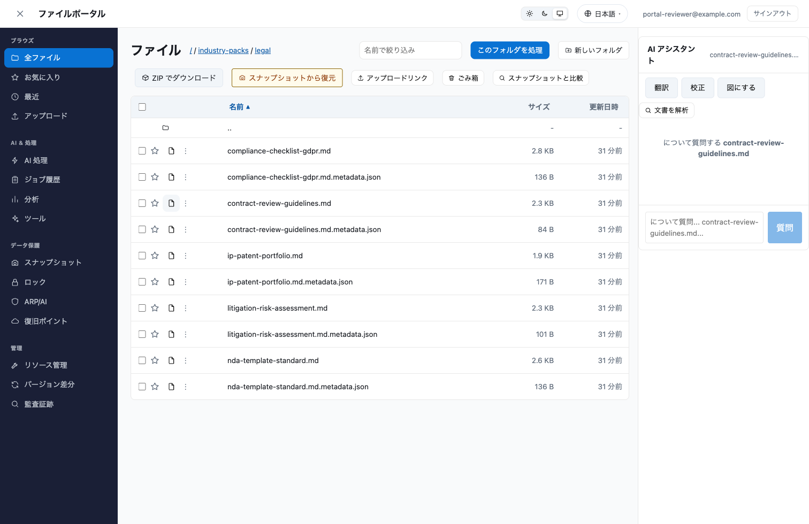
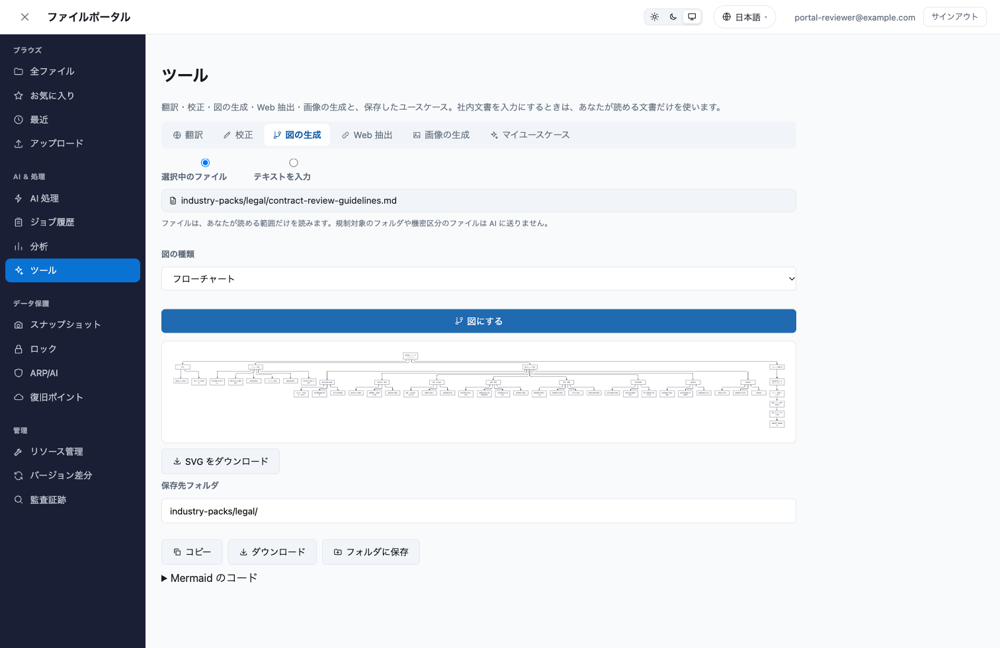
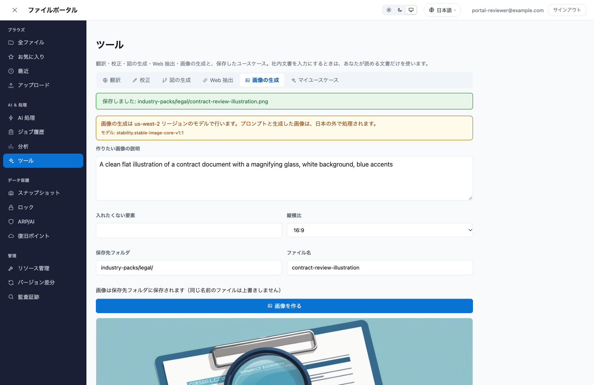

# Tools in the File Portal

🌐 **Language / 言語**: [日本語](file-tools.md) | English

The Tools section in the sidebar translates, proofreads and diagrams files on FSx for ONTAP, summarizes web pages, generates images saved into a folder, and stores frequently used instructions as templates. Selecting a file in the file list shows Translate, Proofread and Diagram buttons in the AI panel on the right, which open the tools with that file as the input. The screenshots were taken on a deployed Amplify sandbox (ap-northeast-1, 2026-11-15).

## What Each Tool Does

| Tool | Input | Result |
|------|-------|--------|
| Translate | The selected file, or pasted text | Translation into 13 languages, with a register and a terminology note. Copy, download, or save into the folder (`<name>.<language>.md`) |
| Proofread | Same as above | Issues (original, suggestion, reason) and the corrected text |
| Diagram | Same as above | One of 9 diagram types drawn in Mermaid. Download as SVG, or save the `.mmd` into the folder |
| Web extraction | URL | Summary, body extraction, or an answer to a question |
| Image generation | Prompt | Generates an image and saves it as PNG into the target folder. Off by default |
| My use cases | The selected file, or text | Runs a saved template with the input in place of `{{input}}` |

## File Reads, Writes and Permissions

- **Reading a file**: `functions/file-tools` checks in the same order as file questions (`ask-about-file`): AI use by external callers, the path boundary (`scope_for_caller`), regulated folders (`/dicom/`, `/phi/`, `/pii/`), then data classification. A file outside the boundary is refused before anything is read. Only the first 100 KB is read
- **Writing**: saving into a folder (results such as translations, and images) goes through `toolsMutation`. When roles are enforced, only the write roles (contributor, storage-admin) can call it. The resolver sets `writeOperation`, so nothing can be written through `toolsQuery`. A file with the same name is not overwritten; `-1` and so on is added
- **Saving use cases**: saving or deleting a use case goes through `toolsUseCaseMutation`. A use case is the user's own prompt template, stored per user ID in a DynamoDB table of its own, and writes nothing to the file system. So, when roles are enforced, any portal role (viewer, contributor, storage-admin, auditor) can call it. An account in no group cannot. This resolver sets only `useCaseOperation`, so nothing can be written into a folder through `toolsUseCaseMutation` <!-- allow:not-a-claim: describes what this app permits, not a vendor limit -->
- **Viewer role**: can translate, proofread, diagram, extract web pages, and create, run and delete use cases. Cannot save into folders
- **Web extraction**: the page is fetched by the Lambda. Hosts resolving to non-public addresses (private, link-local, the metadata address `169.254.169.254`, IPv6 unique local, IPv4-mapped), non-default ports and URLs with credentials are refused. The connection is pinned to the checked address, and each redirect hop is checked again <!-- allow:not-a-claim: describes what this app refuses, not a vendor limit -->

## Settings

Set through `tools` in `amplify/portal-config.ts` or environment variables. An existing `portal-config.ts` without `tools` falls back to the environment variables.

| Environment variable | Default | Meaning |
|----------------------|---------|---------|
| `AMPLIFY_PORTAL_IMAGE_GENERATION_ENABLED` | `false` | Image generation |
| `AMPLIFY_PORTAL_IMAGE_GENERATION_REGION` | `us-west-2` | Region where the image model is called |
| `AMPLIFY_PORTAL_IMAGE_GENERATION_MODEL_ID` | `stability.stable-image-core-v1:1` | Image model. An inference profile (`us.` and so on) also works; IAM follows it |
| `AMPLIFY_PORTAL_WEB_EXTRACT_ENABLED` | `true` | Web extraction |

**[verified 2026-11-14 / ap-northeast-1, us-west-2 and 12 other Regions]** Tokyo has no model with image output. [E-019] Of the 14 Regions checked, text-to-image models (Stable Image Core / Ultra, SD3.5 Large) exist only in us-west-2, with no inference profile. The default is therefore us-west-2, and prompts and images are processed outside Japan, which the screen also states. The text tools use `jp.anthropic.claude-haiku-4-5-20251001-v1:0` (processed in Tokyo and Osaka).

## Results

**[verified 2026-11-15 / ap-northeast-1]** Checked on an Amplify sandbox by a storage-admin user, on files in `industry-packs/legal/`. Times are single observations.

| What was checked | Result |
|---|---|
| English translation of the selected file | 6.7 s. Saved into the folder twice; the second save did not overwrite and became `contract-review-guidelines.md.en-1.md` |
| Diagram (flowchart) | Drawn on screen |
| Image generation (16:9) | `contract-review-illustration.png` was saved into the folder and appeared in the file list |
| Saving a use case and running it on the selected file | Succeeded |
| Web extraction (a public page) | 4.8 s |
| Web extraction of the metadata URL | Refused by the app (`the host resolves to an address that is not allowed`). The portal goes through AppSync, so no WAF sits in front of it |

**Scope**: checked with one user (storage-admin). The path boundary, the refusal of writes for the viewer role and the refusal of regulated folders are checked by the tests in `functions/file-tools/tests/` and `tests/components/FileTools.test.tsx`, not on the live sandbox.

**Defect found and fixed in this check**: saving into a folder failed with 403. Without `s3:ListBucket` on the Lambda role, S3 answers 403 instead of 404 to HeadObject on a missing key [E-020], so "the name is free" could not be told from "denied". Adding `s3:ListBucket` to the role fixed it. Treating 403 as "free" was not done, because it would hide a real refusal.

## Related Documents

| Document | Content |
|----------|---------|
| [Industry use cases](industry-use-cases.en.md) | The AI Processing tab and agent templates |
| [UI contributor guide](CONTRIBUTING-UI.en.md) | Adding a feature to a screen |
