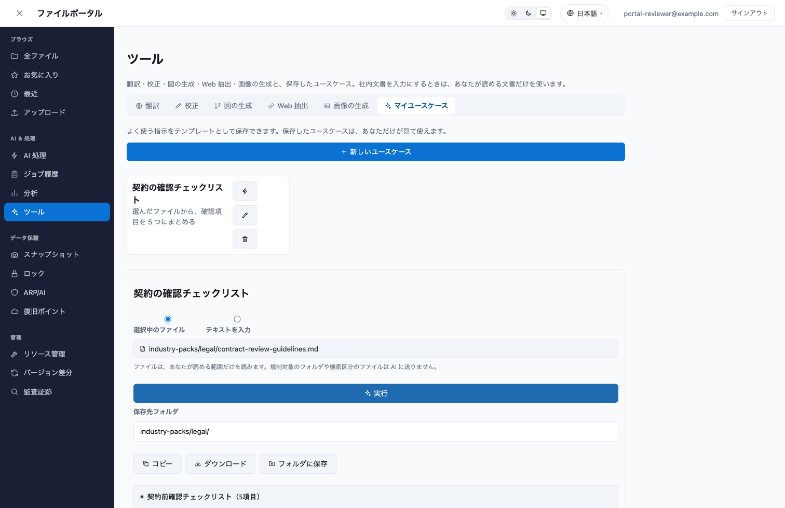

# Tools in the File Portal

🌐 **Language / 言語**: [日本語](file-tools.md) | English

The Tools section in the sidebar translates, proofreads and diagrams files on FSx for ONTAP, summarizes web pages, generates images saved into a folder, and stores frequently used instructions as templates. Selecting a file in the file list shows Translate, Proofread and Diagram buttons in the AI panel on the right, which open the tools with that file as the input. The screenshots were taken on a deployed Amplify sandbox (ap-northeast-1, 2026-11-15).

## What Each Tool Does

| Tool | Input | Result |
|------|-------|--------|
| Translate | The selected file, or pasted text | Translation into 13 languages, with a register and a terminology note. Copy, download, or save into the folder (`<name>.<language>.md`) |
| Proofread | Same as above | Issues (original, suggestion, reason) and the corrected text |
| Diagram | Same as above | One of 9 diagram types drawn in Mermaid. Download as SVG, or save the `.mmd` into the folder |
| Web extraction | URL | Summary, body extraction, or an answer to a question |
| Image generation | Prompt | Generates an image and saves it as PNG into the target folder. Off by default |
| Run code | The selected file or text, and a task | The model writes a Python program, runs it in a sandbox with no network, and answers from the output. Shows the answer, the program, and the outcome and output of each run. Off by default |
| Minutes | The selected recording | Amazon Transcribe transcribes it with speakers separated, and the text model writes a summary, decisions, action items and the main points. Off by default |
| My use cases | The selected file, or text | Runs a saved template with the input in place of `{{input}}` |

## File Reads, Writes and Permissions

- **Reading a file**: `functions/file-tools` checks in the same order as file questions (`ask-about-file`): AI use by external callers, the path boundary (`scope_for_caller`), regulated folders (`/dicom/`, `/phi/`, `/pii/`), then data classification. A file outside the boundary is refused before anything is read. Only the first 100 KB is read
- **Writing**: saving into a folder (results such as translations, and images) goes through `toolsMutation`. When roles are enforced, only the write roles (contributor, storage-admin) can call it. The resolver sets `writeOperation`, so nothing can be written through `toolsQuery`. A file with the same name is not overwritten; `-1` and so on is added
- **Saving use cases**: saving or deleting a use case goes through `toolsUseCaseMutation`. A use case is the user's own prompt template, stored per user ID in a DynamoDB table of its own, and writes nothing to the file system. So, when roles are enforced, any portal role (viewer, contributor, storage-admin, auditor) can call it. An account in no group cannot. This resolver sets only `useCaseOperation`, so nothing can be written into a folder through `toolsUseCaseMutation` <!-- allow:not-a-claim: describes what this app permits, not a vendor limit -->
- **Viewer role**: can translate, proofread, diagram, extract web pages, and create, run and delete use cases. Cannot save into folders
- **Web extraction**: the page is fetched by the Lambda. Hosts resolving to non-public addresses (private, link-local, the metadata address `169.254.169.254`, IPv6 unique local, IPv4-mapped), non-default ports and URLs with credentials are refused. The connection is pinned to the checked address, and each redirect hop is checked again <!-- allow:not-a-claim: describes what this app refuses, not a vendor limit -->

## Run Code
When enabled, a Run code tab appears. Given a task (for example: total the sales column by month and name the highest month) and an input, action `code` of `functions/file-tools` works in this order:

1. It checks the file boundary (`read_file_text`, the same checks as the file question). A file the caller cannot read, or that classification bars from AI, goes to neither the model nor the sandbox; the request stops here.
2. The model writes a Python program. Its prompt holds the task, the fixed name inside the sandbox (`doc1.txt`, or `input.txt` for typed text) and the original extension. It does not hold the file content or the original name.
3. It opens a session of the AgentCore built-in Code Interpreter (`aws.codeinterpreter.v1`), writes the input, runs the program, and stops the session, also after a time-out.
4. On failure, the program and the error (up to 3,000 characters) go back to the model to fix. Output is cut at 6,000 characters. Error and output are wrapped in `<input>`, and the system prompt says not to follow instructions inside.
5. From a successful output, the model writes the answer.

| Limit | Value | Why |
|---|---|---|
| Whole request | 25 s | AppSync waits at most 30 s for a resolver. Raising the Lambda timeout does not help; AppSync gives up first |
| One run | 12 s | The first run gets `min(12 s, 25 s − elapsed − 5 s)`; 5 s is reserved for writing the answer. With under 3 s left, nothing runs |
| Runs | At most 2 | A second run fits only when the first failure came back early. A task that does not fit is reported as not finished in time |

The sandbox has no network. Only the selected file you can read (up to 100 KB) or the text you type goes in. The viewer role can use it: it only reads and writes nothing to a folder, so it has the same permission as `toolsQuery` (saving the result still needs a write role, as for the other tools). The Lambda role gains three actions, `bedrock-agentcore:StartCodeInterpreterSession`, `InvokeCodeInterpreter` and `StopCodeInterpreterSession`, on `arn:aws:bedrock-agentcore:<region>:aws:code-interpreter/aws.codeinterpreter.v1` only (the account part is literally `aws`).
## Minutes
When enabled, a Minutes tab appears. Select a recording in the file list (mp3, m4a, wav, flac, ogg, mp4, webm; up to 200 MB), then choose the recording's language (ja-JP, en-US, ko-KR, zh-CN, fr-FR, de-DE, es-ES) and the maximum number of speakers (2 to 10).

Transcribe takes minutes and AppSync waits at most 30 s for a resolver, so `functions/file-tools` splits the work into two actions.

1. `minutes-start`: checks the file boundary (the same checks as `read_file_text`; a file the caller cannot read, that classification bars from AI, or in a regulated folder stops here), checks the extension and size, then creates the Transcribe job. The input is passed as `s3://<access point alias>/<key>`, so there is no browser upload and no staging bucket. The job name is `portal-minutes-<24 hex characters of the user ID hash>-<uuid>`.
2. `minutes-status`: called by the screen every 5 s (for up to 30 minutes). A job name that does not carry the calling user's hash is answered "job not found" without asking Transcribe. When the job completes, the function checks that the output location Transcribe reports is that user's folder, reads it, builds `spk_0: …` lines (a run of the same speaker is one line) and gives them to the text model. The state lives in the Transcribe job, so there is no DynamoDB table.

The minutes prompt forbids inventing an owner or a due date and writes the headings in the language of the recording. The transcript is wrapped in `<input>`, and the system prompt says not to follow instructions inside it. A transcript over 30,000 characters is cut to its first part, and the screen says so.

Transcribe's output goes to a dedicated ordinary S3 bucket (`MinutesTranscriptBucket`: private, encrypted, expires after 1 day), not to the access point. The Lambda role gains `transcribe:StartTranscriptionJob` and `GetTranscriptionJob` (only on `transcription-job/portal-minutes-*`), and `s3:PutObject` and `s3:GetObject` on `transcripts/*` of that bucket. Transcribe reads the input and writes the output with the caller's permissions, so reading the access point uses the existing permission. The viewer role can use it: nothing is written to a user's folder, so it has the same permission as `toolsQuery`.
## Settings

Set through `tools` in `amplify/portal-config.ts` or environment variables. An existing `portal-config.ts` without `tools` falls back to the environment variables.

| Environment variable | Default | Meaning |
|----------------------|---------|---------|
| `AMPLIFY_PORTAL_IMAGE_GENERATION_ENABLED` | `false` | Image generation |
| `AMPLIFY_PORTAL_IMAGE_GENERATION_REGION` | `us-west-2` | Region where the image model is called |
| `AMPLIFY_PORTAL_IMAGE_GENERATION_MODEL_ID` | `stability.stable-image-core-v1:1` | Image model. An inference profile (`us.` and so on) also works; IAM follows it |
| `AMPLIFY_PORTAL_WEB_EXTRACT_ENABLED` | `true` | Web extraction |
| `AMPLIFY_PORTAL_MINUTES_ENABLED` | `false` | Minutes. `tools.minutes` in `portal-config.ts`. Only when `true` do the transcript bucket, the Transcribe permissions and the tab exist |
| `AMPLIFY_PORTAL_CODE_EXECUTION_ENABLED` | `false` | Run code. `tools.codeExecution` in `portal-config.ts`. Only when `true` do the Lambda's `CODE_INTERPRETER_ENABLED`, the IAM statement and the tab exist |

**[verified 2026-11-14 / ap-northeast-1, us-west-2 and 12 other Regions]** Tokyo has no model with image output. [E-019] Of the 14 Regions checked, text-to-image models (Stable Image Core / Ultra, SD3.5 Large) exist only in us-west-2, with no inference profile. The default is therefore us-west-2, and prompts and images are processed outside Japan, which the screen also states. The text tools use `jp.anthropic.claude-haiku-4-5-20251001-v1:0` (processed in Tokyo and Osaka).

## Results

**[verified 2026-11-15 / ap-northeast-1]** Checked on an Amplify sandbox by a storage-admin user, on files in `industry-packs/legal/`. Times are single observations.

| What was checked | Result |
|---|---|
| English translation of the selected file | 6.7 s. Saved into the folder twice; the second save did not overwrite and became `contract-review-guidelines.md.en-1.md` |
| Diagram (flowchart) | Drawn on screen |
| Image generation (16:9) | `contract-review-illustration.png` was saved into the folder and appeared in the file list |
| Saving a use case and running it on the selected file | Succeeded |
| Web extraction (a public page) | 4.8 s |
| Web extraction of the metadata URL | Refused by the app (`the host resolves to an address that is not allowed`). The portal goes through AppSync, so no WAF sits in front of it |

**Scope**: checked with one user (storage-admin). The path boundary, the refusal of writes for the viewer role and the refusal of regulated folders are checked by the tests in `functions/file-tools/tests/` and `tests/components/FileTools.test.tsx`, not on the live sandbox.

**Defect found and fixed in this check**: saving into a folder failed with 403. Without `s3:ListBucket` on the Lambda role, S3 answers 403 instead of 404 to HeadObject on a missing key [E-020], so "the name is free" could not be told from "denied". Adding `s3:ListBucket` to the role fixed it. Treating 403 as "free" was not done, because it would hide a real refusal.

## Results for Run Code
**Checked (automated tests)**: `functions/file-tools/tests/test_file_tools.py` and `tests/components/FileTools.test.tsx`, with the sandbox and the model stubbed.

- Unless the setting is `true`, nothing runs and neither the sandbox nor the model is called
- Neither the name nor the content of a file the caller cannot read reaches the model or the sandbox. A file that classification bars from AI does not go in. External callers are refused
- The file content goes only into the sandbox, as `doc1.txt` (`input.txt` for typed text), and not into the model prompt
- Repeated failures stop at 2 runs. The error is cut at 3,000 characters and the output at 6,000, wrapped in `<input>`
- No next run starts when time is short (with the model taking 9 s, a second run does not start; at 20 s, not even a first)
- The session is stopped after a time-out, and also when it only opens after the time-out
- The screen shows the tab only when enabled, shows the limits, and sends only the file key and the task through `toolsQuery`

**Checked on a live sandbox (2026-11-15/16, ap-northeast-1)**: deployed to an existing Amplify sandbox with `AMPLIFY_PORTAL_CODE_EXECUTION_ENABLED=true`. AppSync was called with the signed-in browser's token. Times are single observations.

| What was checked | Result |
|---|---|
| A storage-admin user asks for the sales total and the highest month from a CSV on the access point | Total 965, highest month April (410). 6.3 s to the AppSync response. The program succeeded on the first run |
| A task that asks for `time.sleep(120)` (the 25 s budget) | The first run timed out, the second succeeded. Returned in 18.0 s in all, inside AppSync's 30 s |
| A user in the internal group only, with a key outside the allowed prefixes | Refused in 0.18 s with `key is outside the prefixes your groups may access` |
| The same user, with an allowed key | It ran |
| The same user, with a file containing a confidential line (`SECRETSALARY`) | Refused. The confidential line appeared nowhere in that user's responses |
| Screen | The Run code tab, the environment note (Python 3.12, pandas and numpy, up to 2 runs per request, 12 s each, 25 s in all), a run on typed text, and the answer |

**Not checked**: a worst case close to 25 s (for example, the model taking long to write the program and the first run then timing out). The 18.0 s above is one observation, not a bound. A screenshot that includes the answer has not been taken (only the input screen before a run exists, and it is not included in this document). That the sandbox is aarch64, and that a least-privilege role can start, run and stop a session, come from another project's check (the RAG application, ap-northeast-1, 2026-11-15), and were not seen directly by this portal's tests or the live check.

**Found during the check**: the access point that the sandbox's `S3AP_ALIAS` pointed to no longer existed. The check used a throwaway volume and access point swapped in, and the original value was restored afterwards. A live deploy stops when six values in the configuration file that git does not track (access point, ONTAP connection, VPC and others) are empty; that is an intended safeguard. When taking over a sandbox, first check that the configured access point exists.

## Results for Minutes
**Checked (automated tests)**: `functions/file-tools/tests/test_file_tools.py` and `tests/components/FileTools.test.tsx`, with Transcribe, S3 and the model stubbed.

- Unless the setting is `true`, nothing runs and Transcribe is not called
- A file the caller cannot read, that classification bars from AI, or an external caller creates no job (an unreadable file is not even looked up with `head_object`)
- An extension outside the allow list, a file over 200 MB, a language outside the list and a speaker count out of range are refused
- The job name carries the user ID hash (not the ID itself), the input is the alias `s3://` URI, and the output goes under `transcripts/<hash>/`
- Another user's job name, and a name this tool did not make, are answered "job not found" without calling Transcribe
- Output that Transcribe reports outside the user's folder is not read
- The transcript is wrapped in `<input>`, and a run of the same speaker becomes one line. A long transcript is cut to its first part and `truncated` is returned
- The screen shows the tab only when enabled, sends only the file key, polls every 5 s, shows the minutes on completion, and shows the reason on failure

**Checked live (2026-11-16, ap-northeast-1)**: with a throwaway volume, access point and output bucket, the handler in `functions/file-tools/index.py` was called directly from a workstation against real Transcribe, the S3 access point and Bedrock. AppSync and Cognito were not in the path. The recording is a 17-second, 141 KB mp3 made with two Japanese Polly voices. Times are single observations.

| What was checked | Result |
|---|---|
| Transcribe reads the alias `s3://` URI | It did. The job finished in about 11 s and its output landed under `transcripts/<hash>/` in the bucket |
| A key with a space and Japanese characters (`minutes/会議 録音.mp3`) | Finished the same way |
| `minutes-start` duration (including `head_object` and creating the job) | 1.9 s |
| `minutes-status` duration (including reading the output and one model call) | 2.0 s |
| The minutes | A summary, decisions (release on December 5), action items and the main points. The missing due date was written as not stated |
| A `team-b` user asking for a `minutes/` key; a `team-a` user asking for an `other/` key outside the allowed prefix | Both refused with `key is outside the prefixes your groups may access` (0.0 s). No job was created |
| An extension outside the allow list (`.pdf`) | Refused |
| Another user passing someone else's job name to `minutes-status` | `job not found`; Transcribe was not asked |
| Shape of `audio_segments` | Carries `speaker_label` and `transcript`, as assumed |

**Not checked**: a call through AppSync and Cognito, and the screen in a browser. A real deployment (the CDK bucket and IAM; the check ran with administrator credentials, so the Lambda role's least-privilege policy was not exercised). Speaker separation: the two synthetic voices came back as one speaker (`spk_0`), so the minutes also named `spk_0` as the owner. Accuracy on a real meeting recording was not measured. Long recordings (tens of minutes).

## Related Documents

| Document | Content |
|----------|---------|
| [Industry use cases](industry-use-cases.en.md) | The AI Processing tab and agent templates |
| [UI contributor guide](CONTRIBUTING-UI.en.md) | Adding a feature to a screen |
