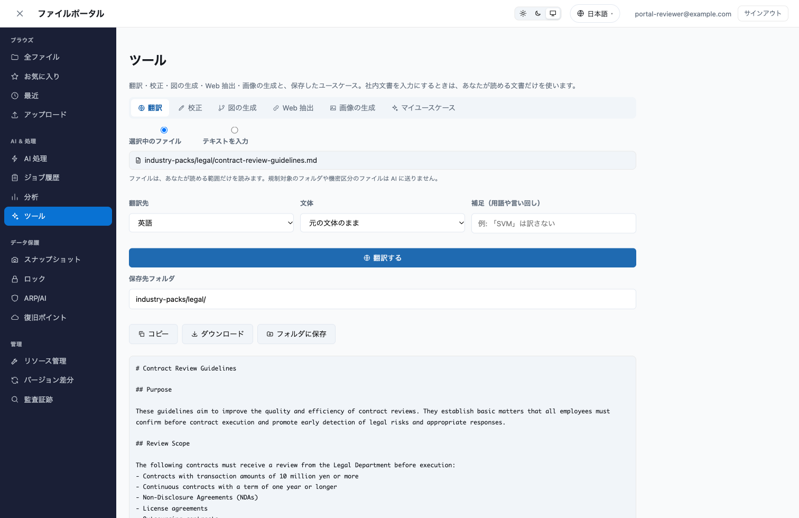

# Tools in the File Portal

🌐 **Language / 言語**: [日本語](file-tools.md) | English

The Tools section in the sidebar translates, proofreads and diagrams files on FSx for ONTAP, summarizes web pages, generates images saved into a folder, and stores frequently used instructions as templates. Selecting a file in the file list shows Translate, Proofread and Diagram buttons in the AI panel on the right, which open the tools with that file as the input. The screenshots were taken on a deployed Amplify sandbox (ap-northeast-1, 2026-11-15).

## What Each Tool Does

| Tool | Input | Result |
|------|-------|--------|
| Translate | The selected file, or pasted text | Translation into 13 languages, with a register and a terminology note. Copy, download, or save into the folder (`<name>.<language>.md`) |
| Proofread | Same as above | Issues (original, suggestion, reason) and the corrected text |
| Diagram | Same as above | One of 9 diagram types drawn in Mermaid. Download as SVG, or save the `.mmd` into the folder |
| Web extraction | URL | Summary, body extraction, or an answer to a question |
| Image generation | Prompt | Generates an image and saves it as PNG into the target folder. Off by default |
| Run code | The selected file or text, and a task | The model writes a Python program, runs it in a sandbox with no network, and answers from the output. Shows the answer, the program, and the outcome and output of each run. Off by default |
| Video analysis | The selected video (mp4, mov, webm, mkv) and a request | Nova 2 Lite watches the video and answers the request (a summary if left empty). It answers in one call, so a video over 50 MB is refused. Off by default |
| Video generation | A prompt | Luma Ray v2 makes a 5-second video, played and downloaded through a link valid for 10 minutes. The model exists only in us-west-2, so the prompt and the video are processed and stored outside Japan. Off by default |
| Minutes | The selected recording | Amazon Transcribe transcribes it with speakers separated, and the text model writes a summary, decisions, action items and the main points. Off by default |
| My use cases | The selected file, or text | Runs a saved template with the input in place of `{{input}}` |

## File Reads, Writes and Permissions

- **Reading a file**: `functions/file-tools` checks in the same order as file questions (`ask-about-file`): AI use by external callers, the path boundary (`scope_for_caller`), regulated folders (`/dicom/`, `/phi/`, `/pii/`), then data classification. A file outside the boundary is refused before anything is read. Only the first 100 KB is read
- **Writing**: saving into a folder (results such as translations, and images) goes through `toolsMutation`. When roles are enforced, only the write roles (contributor, storage-admin) can call it. The resolver sets `writeOperation`, so nothing can be written through `toolsQuery`. A file with the same name is not overwritten; `-1` and so on is added
- **Saving use cases**: saving or deleting a use case goes through `toolsUseCaseMutation`. A use case is the user's own prompt template, stored per user ID in a DynamoDB table of its own, and writes nothing to the file system. So, when roles are enforced, any portal role (viewer, contributor, storage-admin, auditor) can call it. An account in no group cannot. This resolver sets only `useCaseOperation`, so nothing can be written into a folder through `toolsUseCaseMutation` <!-- allow:not-a-claim: describes what this app permits, not a vendor limit -->
- **Viewer role**: can translate, proofread, diagram, extract web pages, and create, run and delete use cases. Cannot save into folders
- **Web extraction**: the page is fetched by the Lambda. Hosts resolving to non-public addresses (private, link-local, the metadata address `169.254.169.254`, IPv6 unique local, IPv4-mapped), non-default ports and URLs with credentials are refused. The connection is pinned to the checked address, and each redirect hop is checked again <!-- allow:not-a-claim: describes what this app refuses, not a vendor limit -->

## Run Code
When enabled, a Run code tab appears. Given a task (for example: total the sales column by month and name the highest month) and an input, action `code` of `functions/file-tools` works in this order:

1. It checks the file boundary (`read_file_text`, the same checks as the file question). A file the caller cannot read, or that classification bars from AI, goes to neither the model nor the sandbox; the request stops here.
2. The model writes a Python program. Its prompt holds the task, the fixed name inside the sandbox (`doc1.txt`, or `input.txt` for typed text) and the original extension. It does not hold the file content or the original name.
3. It opens a session of the AgentCore built-in Code Interpreter (`aws.codeinterpreter.v1`), writes the input, runs the program, and stops the session, also after a time-out.
4. On failure, the program and the error (up to 3,000 characters) go back to the model to fix. Output is cut at 6,000 characters. Error and output are wrapped in `<input>`, and the system prompt says not to follow instructions inside.
5. From a successful output, the model writes the answer.

| Limit | Value | Why |
|---|---|---|
| Whole request | 25 s | AppSync waits at most 30 s for a resolver. Raising the Lambda timeout does not help; AppSync gives up first |
| One run | 12 s | The first run gets `min(12 s, 25 s − elapsed − 5 s)`; 5 s is reserved for writing the answer. With under 3 s left, nothing runs |
| Runs | At most 2 | A second run fits only when the first failure came back early. A task that does not fit is reported as not finished in time |

The sandbox has no network. Only the selected file you can read (up to 100 KB) or the text you type goes in. The viewer role can use it: it only reads and writes nothing to a folder, so it has the same permission as `toolsQuery` (saving the result still needs a write role, as for the other tools). The Lambda role gains three actions, `bedrock-agentcore:StartCodeInterpreterSession`, `InvokeCodeInterpreter` and `StopCodeInterpreterSession`, on `arn:aws:bedrock-agentcore:<region>:aws:code-interpreter/aws.codeinterpreter.v1` only (the account part is literally `aws`).

## Minutes
When enabled, a Minutes tab appears. Select a recording in the file list (mp3, m4a, wav, flac, ogg, mp4, webm; up to 200 MB), then choose the recording's language (ja-JP, en-US, ko-KR, zh-CN, fr-FR, de-DE, es-ES) and the maximum number of speakers (2 to 10).

Transcribe takes minutes and AppSync waits at most 30 s for a resolver, so `functions/file-tools` splits the work into two actions.

1. `minutes-start`: checks the file boundary (the same checks as `read_file_text`; a file the caller cannot read, that classification bars from AI, or in a regulated folder stops here), checks the extension and size, then creates the Transcribe job. The input is passed as `s3://<access point alias>/<key>`, so there is no browser upload and no staging bucket. The job name is `portal-minutes-<24 hex characters of the user ID hash>-<uuid>`.
2. `minutes-status`: called by the screen every 5 s (for up to 30 minutes). A job name that does not carry the calling user's hash is answered "job not found" without asking Transcribe. When the job completes, the function checks that the output location Transcribe reports is that user's folder, reads it, builds `spk_0: …` lines (a run of the same speaker is one line) and gives them to the text model. The state lives in the Transcribe job, so there is no DynamoDB table.

The minutes prompt forbids inventing an owner or a due date and writes the headings in the language of the recording. The transcript is wrapped in `<input>`, and the system prompt says not to follow instructions inside it. A transcript over 30,000 characters is cut to its first part, and the screen says so.

Transcribe's output goes to a dedicated ordinary S3 bucket (`MinutesTranscriptBucket`: private, encrypted, expires after 1 day), not to the access point. The Lambda role gains `transcribe:StartTranscriptionJob` and `GetTranscriptionJob` (only on `transcription-job/portal-minutes-*`), and `s3:PutObject` and `s3:GetObject` on `transcripts/*` of that bucket. Transcribe reads the input and writes the output with the caller's permissions, so reading the access point uses the existing permission. The viewer role can use it: nothing is written to a user's folder, so it has the same permission as `toolsQuery`.

## Video Analysis
When enabled, a Video analysis tab appears. Select a video (mp4, mov, webm, mkv) and type a request (a summary if left empty). The model is `jp.amazon.nova-2-lite-v1:0`, and the video is passed to the Bedrock Converse `video` block as `s3://<access point alias>/<key>`: no upload and no staging bucket. The file checks (boundary, regulated folders, classification, external callers), the extension and the size run in the same order as for minutes, before the model is called. The system prompt says that text and speech inside the video are content to report, never instructions.

AppSync waits at most 30 s, so **one call (`video`) has to finish within 25 s, and only files too large for that are refused.** The model call has a 20 s read timeout and the whole action is cut at 25 s; both answer that the analysis did not finish in time. The size limit is `VIDEO_ANALYSIS_MAX_MB` (default 50). A larger video is refused before the model is called with `file too large for synchronous analysis (limit N MB)`. The basis for the limit is the measurement in "Results for Video Analysis" below. An asynchronous route for videos that do not fit is left for a separate change, if this limit proves too small in practice.

**The audio is not analyzed.** Nova 2 Lite's video understanding uses the frames only (one per second for videos of 16 minutes or less) and does not process the audio track ([Amazon Nova 2 multimodal understanding](https://docs.aws.amazon.com/nova/latest/nova2-userguide/using-multimodal-models.html), "No audio support"). Use Minutes when what was said matters. The screen shows the limit, that the audio is not analyzed, and that text on screen can lose its last character from one run to the next, so the original video should be checked when accuracy matters. The Lambda role gains only `bedrock:InvokeModel` on the Nova 2 Lite inference profile and the Tokyo and Osaka foundation models. Reading the video uses the existing access point permission. The viewer role can use it. Nothing is written to a user's folder.

## Video Generation
When enabled, a Video generation tab appears. Type a prompt and choose an aspect ratio (16:9, 9:16) and a resolution (540p, 720p), and `luma.ray-v2:0` makes a 5-second video. **This model exists only in us-west-2 (of 12 Regions checked with `list-foundation-models` on 2026-11-16), so the prompt and the generated video are processed and stored outside Japan.** The screen says so before anything is sent (the same pattern as image generation). Only values that were actually run are allowed. The 2,000-character prompt cap is this tool's own.

Generation takes 36 to 74 s, which does not fit AppSync's 30 s, so the work is split into `video-generate-start` and `video-generate-status`.

1. `video-generate-start`: calls `StartAsyncInvoke` on Bedrock Runtime in us-west-2. The output goes to `s3://<output bucket>/videos/<hash of the user ID>/<uuid>/`. When several are started at once and one gets `ThrottlingException`, it answers that the model is busy.
2. `video-generate-status`: called by the screen every 5 s. The `invocationArn` the client sends is checked for its shape (Region and a 12-digit account), passed to `GetAsyncInvoke`, and answered "job not found" unless the output location the service reports is the calling user's folder (`videos/<hash>/`). When complete, it returns a presigned URL (10 minutes) for `output.mp4`.

The output bucket is an **existing bucket you name**. An Amplify stack deploys to one Region and the bucket must sit beside the model, so the portal's CDK does not create it. Deploy `infrastructure/video-output-bucket.yaml` in us-west-2 and put its `BucketName` output into `tools.videoGeneration.outputBucket` (or `AMPLIFY_PORTAL_VIDEO_GENERATION_BUCKET`). The bucket is private, encrypted, TLS-only, and expires objects after 1 day. Enabling the tool with an empty `outputBucket` stops the deploy with a message that names `tools.videoGeneration.outputBucket`.

The Lambda role gains `bedrock:InvokeModel` and `StartAsyncInvoke` on the model, `bedrock:InvokeModel` and `GetAsyncInvoke` on the account's `async-invoke/*`, and `s3:PutObject` and `s3:GetObject` on `videos/*` of the output bucket. The presigned URL is signed for the Region endpoint of the output bucket. The viewer role can use it. Nothing is written to a user's folder.

## Settings

Set through `tools` in `amplify/portal-config.ts` or environment variables. An existing `portal-config.ts` without `tools` falls back to the environment variables.

| Environment variable | Default | Meaning |
|----------------------|---------|---------|
| `AMPLIFY_PORTAL_IMAGE_GENERATION_ENABLED` | `false` | Image generation |
| `AMPLIFY_PORTAL_IMAGE_GENERATION_REGION` | `us-west-2` | Region where the image model is called |
| `AMPLIFY_PORTAL_IMAGE_GENERATION_MODEL_ID` | `stability.stable-image-core-v1:1` | Image model. An inference profile (`us.` and so on) also works; IAM follows it |
| `AMPLIFY_PORTAL_WEB_EXTRACT_ENABLED` | `true` | Web extraction |
| `AMPLIFY_PORTAL_VIDEO_GENERATION_ENABLED` | `false` | Video generation. `tools.videoGeneration.enabled` in `portal-config.ts` |
| `AMPLIFY_PORTAL_VIDEO_GENERATION_BUCKET` | none | Existing bucket for the videos, in the model's Region. Required when enabled |
| `AMPLIFY_PORTAL_VIDEO_GENERATION_REGION` | `us-west-2` | Region where the video model is called |
| `AMPLIFY_PORTAL_VIDEO_ANALYSIS_ENABLED` | `false` | Video analysis. `tools.videoAnalysis.enabled` in `portal-config.ts` |
| `AMPLIFY_PORTAL_VIDEO_ANALYSIS_MAX_MB` | `50` | Largest video accepted for analysis (1 to 200). The measured value is the default. `tools.videoAnalysis.maxMegabytes` |
| `AMPLIFY_PORTAL_MINUTES_ENABLED` | `false` | Minutes. `tools.minutes` in `portal-config.ts`. Only when `true` do the transcript bucket, the Transcribe permissions and the tab exist |
| `AMPLIFY_PORTAL_CODE_EXECUTION_ENABLED` | `false` | Run code. `tools.codeExecution` in `portal-config.ts`. Only when `true` do the Lambda's `CODE_INTERPRETER_ENABLED`, the IAM statement and the tab exist |

**[verified 2026-11-14 / ap-northeast-1, us-west-2 and 12 other Regions]** Tokyo has no model with image output. [E-019] Of the 14 Regions checked, text-to-image models (Stable Image Core / Ultra, SD3.5 Large) exist only in us-west-2, with no inference profile. The default is therefore us-west-2, and prompts and images are processed outside Japan, which the screen also states. The text tools use `jp.anthropic.claude-haiku-4-5-20251001-v1:0` (processed in Tokyo and Osaka).

## Results

**[verified 2026-11-15 / ap-northeast-1]** Checked on an Amplify sandbox by a storage-admin user, on files in `industry-packs/legal/`. Times are single observations.

| What was checked | Result |
|---|---|
| English translation of the selected file | 6.7 s. Saved into the folder twice; the second save did not overwrite and became `contract-review-guidelines.md.en-1.md` |
| Diagram (flowchart) | Drawn on screen |
| Image generation (16:9) | `contract-review-illustration.png` was saved into the folder and appeared in the file list |
| Saving a use case and running it on the selected file | Succeeded |
| Web extraction (a public page) | 4.8 s |
| Web extraction of the metadata URL | Refused by the app (`the host resolves to an address that is not allowed`). The portal goes through AppSync, so no WAF sits in front of it |

**Scope**: checked with one user (storage-admin). The path boundary, the refusal of writes for the viewer role and the refusal of regulated folders are checked by the tests in `functions/file-tools/tests/` and `tests/components/FileTools.test.tsx`, not on the live sandbox.

**Defect found and fixed in this check**: saving into a folder failed with 403. Without `s3:ListBucket` on the Lambda role, S3 answers 403 instead of 404 to HeadObject on a missing key [E-020], so "the name is free" could not be told from "denied". Adding `s3:ListBucket` to the role fixed it. Treating 403 as "free" was not done, because it would hide a real refusal.

## Results for Run Code
**Checked (automated tests)**: `functions/file-tools/tests/test_file_tools.py` and `tests/components/FileTools.test.tsx`, with the sandbox and the model stubbed.

- Unless the setting is `true`, nothing runs and neither the sandbox nor the model is called
- Neither the name nor the content of a file the caller cannot read reaches the model or the sandbox. A file that classification bars from AI does not go in. External callers are refused
- The file content goes only into the sandbox, as `doc1.txt` (`input.txt` for typed text), and not into the model prompt
- Repeated failures stop at 2 runs. The error is cut at 3,000 characters and the output at 6,000, wrapped in `<input>`
- No next run starts when time is short (with the model taking 9 s, a second run does not start; at 20 s, not even a first)
- The session is stopped after a time-out, and also when it only opens after the time-out
- The screen shows the tab only when enabled, shows the limits, and sends only the file key and the task through `toolsQuery`

**Checked on a live sandbox (2026-11-15/16, ap-northeast-1)**: deployed to an existing Amplify sandbox with `AMPLIFY_PORTAL_CODE_EXECUTION_ENABLED=true`. AppSync was called with the signed-in browser's token. Times are single observations.

| What was checked | Result |
|---|---|
| A storage-admin user asks for the sales total and the highest month from a CSV on the access point | Total 965, highest month April (410). 6.3 s to the AppSync response. The program succeeded on the first run |
| A task that asks for `time.sleep(120)` (the 25 s budget) | The first run timed out, the second succeeded. Returned in 18.0 s in all, inside AppSync's 30 s |
| A user in the internal group only, with a key outside the allowed prefixes | Refused in 0.18 s with `key is outside the prefixes your groups may access` |
| The same user, with an allowed key | It ran |
| The same user, with a file containing a confidential line (`SECRETSALARY`) | Refused. The confidential line appeared nowhere in that user's responses |
| Screen | The Run code tab, the environment note (Python 3.12, pandas and numpy, up to 2 runs per request, 12 s each, 25 s in all), a run on typed text, and the answer |

**Not checked**: a worst case close to 25 s (for example, the model taking long to write the program and the first run then timing out). The 18.0 s above is one observation, not a bound. A screenshot that includes the answer has not been taken (only the input screen before a run exists, and it is not included in this document). That the sandbox is aarch64, and that a least-privilege role can start, run and stop a session, come from another project's check (the RAG application, ap-northeast-1, 2026-11-15), and were not seen directly by this portal's tests or the live check.

**Found during the check**: the access point that the sandbox's `S3AP_ALIAS` pointed to no longer existed. The check used a throwaway volume and access point swapped in, and the original value was restored afterwards. A live deploy stops when six values in the configuration file that git does not track (access point, ONTAP connection, VPC and others) are empty; that is an intended safeguard. When taking over a sandbox, first check that the configured access point exists.

## Results for Minutes
**Checked (automated tests)**: `functions/file-tools/tests/test_file_tools.py` and `tests/components/FileTools.test.tsx`, with Transcribe, S3 and the model stubbed.

- Unless the setting is `true`, nothing runs and Transcribe is not called
- A file the caller cannot read, that classification bars from AI, or an external caller creates no job (an unreadable file is not even looked up with `head_object`)
- An extension outside the allow list, a file over 200 MB, a language outside the list and a speaker count out of range are refused
- The job name carries the user ID hash (not the ID itself), the input is the alias `s3://` URI, and the output goes under `transcripts/<hash>/`
- Another user's job name, and a name this tool did not make, are answered "job not found" without calling Transcribe
- Output that Transcribe reports outside the user's folder is not read
- The transcript is wrapped in `<input>`, and a run of the same speaker becomes one line. A long transcript is cut to its first part and `truncated` is returned
- The screen shows the tab only when enabled, sends only the file key, polls every 5 s, shows the minutes on completion, and shows the reason on failure

**Checked live (2026-11-16, ap-northeast-1)**: with a throwaway volume, access point and output bucket, the handler in `functions/file-tools/index.py` was called directly from a workstation against real Transcribe, the S3 access point and Bedrock. AppSync and Cognito were not in the path. The recording is a 17-second, 141 KB mp3 made with two Japanese Polly voices. Times are single observations.

| What was checked | Result |
|---|---|
| Transcribe reads the alias `s3://` URI | It did. The job finished in about 11 s and its output landed under `transcripts/<hash>/` in the bucket |
| A key with a space and non-ASCII (Japanese) characters | Finished the same way |
| `minutes-start` duration (including `head_object` and creating the job) | 1.9 s |
| `minutes-status` duration (including reading the output and one model call) | 2.0 s |
| The minutes | A summary, decisions (release on December 5), action items and the main points. The missing due date was written as not stated |
| A `team-b` user asking for a `minutes/` key; a `team-a` user asking for an `other/` key outside the allowed prefix | Both refused with `key is outside the prefixes your groups may access` (0.0 s). No job was created |
| An extension outside the allow list (`.pdf`) | Refused |
| Another user passing someone else's job name to `minutes-status` | `job not found`; Transcribe was not asked |
| Shape of `audio_segments` | Carries `speaker_label` and `transcript`, as assumed |
| Events of the shape AppSync sends, invoked directly on a throwaway Lambda (this repository's `index.py` and `shared/`, with a role of the same least-privilege policy as the CDK) | `minutes-start` 1.6 s, about 15 s from start to completion, minutes returned. Another user got `job not found`. The role's Transcribe and S3 permissions were sufficient |

**Checked through AppSync, Cognito, the screen and CDK (2026-11-16, ap-northeast-1)**: the branch containing this change was deployed to an existing Amplify sandbox with `AMPLIFY_PORTAL_MINUTES_ENABLED=true` (CDK, about 160 s), and two throwaway Cognito users signed in (`viewer` and `auditor`, both also `internal`). The access point is on a throwaway volume. The allowed prefixes are `minutes/` and `video/` for `viewer`, and `other/` for `auditor`. The screen ran from `npm run dev`, and direct AppSync calls used the signed-in browser's token.

| What was checked | Result |
|---|---|
| The `viewer` user opens the file list | Only `minutes` and `video` are visible; `other` is not |
| The same user selects `minutes/meeting.mp3` and presses "Make minutes" on the Minutes tab | The minutes appeared on screen in 21 s. The viewer role (no write permission) could use it, with the output bucket and IAM role that CDK created |
| The `auditor` user sends `minutes-start` to AppSync for `minutes/meeting.mp3` | `key is outside the prefixes your groups may access` |
| The same user sends `minutes-status` with the `viewer` user's job name | `job not found` |
| The same user sends `minutes-start` for the allowed `other/board.mp3` | The job started |

**Checked on a real recording (2026-11-16, ap-northeast-1)**: 10 minutes of Q&A from a NASA news conference ([PACE Prelaunch News Conference](https://images.nasa.gov/details/PACE%20Prelaunch%20News%20Conference)) were made into an English mp3 (64 kbps, 4.6 MB), and the handler was called from a workstation against real Transcribe, the access point and Bedrock. One run with `en-US` and at most 6 speakers.

| What was checked | Result |
|---|---|
| Time | `minutes-start` 1.8 s. About 79 s from the start to the minutes (state checked every 10 s) |
| Speaker separation | Three speakers (`spk_0` 26 segments, `spk_1` 15, `spk_2` 4; 45 in all). Reading the transcript, `spk_0` is the scientist answering, `spk_1` the host reading out the questions, and `spk_2` a reporter asking by phone; the turns matched |
| The minutes | The summary and main points (phytoplankton, aerosols, a 3-year design life with 10 years of fuel, and so on) matched the transcript. Decisions and action items were written as not recorded, with no invented owners or due dates |

**Checked on a real Japanese recording (2026-11-17, ap-northeast-1)**: the audio of a [Chief Cabinet Secretary press conference (13 November 2026, morning)](https://www.kantei.go.jp/jp/tyoukanpress/202611/13_a.html) published by the Prime Minister's Office, 11 min 27 s (mp3, 64 kbps, 5.2 MB), one run with `ja-JP` and at most 6 speakers. It has an opening statement and Q&A with about four reporters.

| What was checked | Result |
|---|---|
| Time | About 181 s from the start to the minutes |
| Transcript accuracy | For the opening statement (about 4 min 30 s), the character error rate against the official transcript on the same page (1,344 characters) was about 7.8%. Notation differences (the same word written in kanji or in kana) count as errors, so this is an upper bound. Names were misheard: the Prime Minister's surname (Takaichi) came out as another surname, the Chilean president's name (Kast) as an unrelated word, and NVIDIA as "NPDI" |
| Speaker separation | Five speakers. The statement and every answer went to one speaker (40 of 49 segments). Each reporter, who gives their outlet's name, became a separate speaker, but the moderator's "go ahead" was merged with a reporter's speaker or segment in places |
| The minutes | The amounts (651.9, 521.9 and 130 billion yen) and the dates (16 to 19, 19 to 21 and 19 to 20 November) matched the official transcript. The transcript's "NPDI" was corrected to NVIDIA in the minutes. Owners and due dates were written as unknown, not invented |

**Against reference speaker labels (2026-11-17)**: the mixed audio of meeting ES2004a from the [AMI Meeting Corpus](https://groups.inf.ed.ac.uk/ami/corpus/) (CC BY 4.0; English, 4 people, 17 min 29 s), scored with [pyannote's AMI speaker labels](https://github.com/pyannote/AMI-diarization-setup). In 10 ms steps, over the stretches where exactly one person speaks (663 s), the share whose speaker matched the best-corresponding Transcribe speaker was counted.

| Maximum speakers | Speakers found | Matched | Given no speaker by Transcribe | Time |
|---|---|---|---|---|
| 4 | 4 | 86.9% | 10.9% | about 212 s |
| 10 | 4 | 86.9% | 10.9% | about 200 s |

The remaining 2% or so went to the wrong person. Stretches where two or more people speak at once (124 s) are not counted. Setting the maximum to 4 or to 10 gave the same result.

**Not checked**: a real Japanese meeting with a few people taking short, overlapping turns (the press conference above is one person speaking at length); scoring a Japanese recording with reference speaker labels; recordings over an hour.

## Results for Video Analysis
**Checked (automated tests)**: `functions/file-tools/tests/test_file_tools.py` and `tests/components/FileTools.test.tsx`, with the model and S3 stubbed.

- With the setting `false`, nothing runs and the model is not called; an external caller is refused
- Bedrock gets the access point alias URI, the system prompt holds no file name, and the request is wrapped in `<input>`
- An unreadable video, one that classification bars from AI, an extension outside the list and a video over the limit do not reach the model. The refusal for size carries the limit in its message, and the limit is a setting
- A call over 25 s and a read timeout from the model call both answer that the analysis did not finish in time
- The asynchronous `video-start` and `video-status` do not exist
- The screen shows the tab only when enabled, shows the limit, the time and the on-screen text note, sends only the file key and the request through `video`, and shows a refusal

**Measuring the limit (2026-11-16, ap-northeast-1)**: events of the shape AppSync sends were invoked directly on a throwaway Lambda (this repository's `index.py` and `shared/`, a least-privilege role, 512 MB), against synthetic videos on an access point on a throwaway volume. The model was `jp.amazon.nova-2-lite-v1:0` and the request was the default summary. Each point was measured 3 times. Times are the whole Lambda invocation. On the size axis, the size was changed through the bitrate of a 60-second video (video only). On the length axis, the length of a test pattern with a sine tone was changed at about 1.5 Mbps.

| Axis | Video | Run 1 | Run 2 | Run 3 | Slowest |
|---|---|---|---|---|---|
| Size (60 s) | 4 MB | 6.6 s | 4.9 s | 4.2 s | 6.6 s |
| | 15 MB | 5.5 s | 5.6 s | 6.1 s | 6.1 s |
| | 46 MB | 6.9 s | 7.3 s | 7.6 s | 7.6 s |
| | 90 MB | 8.6 s | 7.9 s | 8.1 s | 8.6 s |
| | 195 MB | 12.1 s | 11.1 s | 12.0 s | 12.1 s |
| Length (about 1.5 Mbps) | 10 s (1 MB) | 4.5 s | 4.0 s | 4.8 s | 4.8 s |
| | 1 min (11 MB) | 7.4 s | 6.3 s | 5.0 s | 7.4 s |
| | 5 min (56 MB) | 18.1 s | 14.5 s | 13.5 s | 18.1 s |
| | 7 min (78 MB) | 25.7 s (timed out) | 15.2 s | 18.9 s | 25.7 s |
| | 10 min (112 MB) | 25.1 s (timed out) | 25.0 s (timed out) | 25.1 s (timed out) | timed out |

**Reading it**: the time follows the length of the video, not its size. A 60-second video took 12.1 s even at 195 MB, while a 10-minute video of the same 112 MB timed out all three times, and a 7-minute one (78 MB) timed out once. The largest point on the length axis that always fit in 25 s is 5 minutes (56 MB, slowest 18.1 s). The size of a file does not tell its length, so the default limit is **50 MB**, just under that 5-minute point; at about 1.5 Mbps it is roughly four and a half minutes. The limit has these edges:

- A long video at a low bitrate can fit in 50 MB and still take more than 25 s. It then answers that the analysis did not finish in time.
- A short video at a high bitrate is refused above 50 MB even though time would allow it (12 s at 195 MB). Raise `VIDEO_ANALYSIS_MAX_MB` for such videos.
- All of this is one kind of synthetic video. Real footage, other bitrates and busy periods were not measured. No check on the length of the video was added; if needed, one that reads the length from the `moov` box can be added in a separate change.

**Checked through AppSync, Cognito, the screen and CDK (2026-11-16, ap-northeast-1)**: this build (synchronous only) was deployed to an existing Amplify sandbox with `AMPLIFY_PORTAL_VIDEO_ANALYSIS_ENABLED=true` (CDK, about 210 s; Lambda timeout 30 s, `VIDEO_ANALYSIS_MAX_MB=50`) and checked with two throwaway Cognito users. `viewer` can read only `video/` and `auditor` only `other/`. The videos are the ones from the measurement above.

| What was checked | Result |
|---|---|
| The `viewer` user selects the 1-minute, 11 MB video and presses "Analyze the video" | A Japanese answer appeared on screen in 6.1 s from the click |
| The same user runs the 60-second, 90 MB video | `file too large for synchronous analysis (limit 50 MB)` appeared on screen in 1.5 s |
| The same user sends the 5-minute, 56 MB video to AppSync | The same refusal (56 MB is over 50 MB) |
| The same user sends `video-start` and `video-status` | `unknown action` |
| The `auditor` user sends a video under `video/` | `key is outside the prefixes your groups may access` |

**Checked on real footage (2026-11-16, ap-northeast-1)**: two clips cut from a NASA news conference video ([PACE Prelaunch News Conference](https://images.nasa.gov/details/PACE%20Prelaunch%20News%20Conference), 1280×720), with the handler called from a workstation against real Bedrock and the access point: the first 165 s (46.7 MB; one speaker, then six people at a table) and 180 s of Q&A (47.0 MB; six people at a table). The first 180 s (51.0 MB) was refused by the limit. One run per request, 8.6 to 15.6 s each.

| Request | Result |
|---|---|
| Write out all text on screen | Opening clip: `NASA / PACE / NASA / JIM FREE / NASA ASSOCIATE ADMINISTRATOR` (matching what is shown, including the caption's name and title). Q&A clip: only `PACE` (the `NASA` logo was not written out) |
| Number and positions of the people | Q&A clip: 6 people with their clothes, left to right, matching the footage. Opening clip: once "7 people" followed by a list of 6, another time 6 |
| Summary | The setting (news conference, satellite image behind, flags, logos) matched the footage. What was said was invented ("speaker 1 explains ...") |
| Three main points of what is said (twice before and twice after the system-prompt note) | **Invented all four times**, unrelated to the talk (PACE is an Earth-observing satellite; the answers spoke of "searching for water on other worlds") |

**Dealing with invented speech**: the model gets no audio, so it invents an answer when asked what was said. Writing "the audio is not given to you; do not describe speech" in the system prompt did not stop that (4 of 4 runs). Adding the same note to the user message made it answer "the audio is not analyzed" for speech, but it then **refused to write out the on-screen text as well** (4 of 4 runs across two wordings). Reading text on screen is worth more in this tool, so the user-message note is not used; the system prompt and the screen's "the audio is not analyzed; use Minutes for what was said" carry it. **Answers about what was said have no basis, as the screen states.**

**Checked on other kinds of footage (2026-11-17, ap-northeast-1)**: one run per request, 3.6 to 11.4 s each.

| Footage | Request | Result |
|---|---|---|
| A Japanese press conference (the first 120 s of the Chief Cabinet Secretary press conference above, 1920×1080, 34.5 MB) | On-screen text | The date, the title of the conference and the copyright line of the Cabinet Public Relations Office, with the era name (Reiwa) misread as another word |
| | Summary | Correctly said that a sign-language interpreter stands beside the speaker. Wrote the year as "2023" (the footage shows only the Japanese era year, Reiwa 8, which is 2026) and described a flag and reporters that are not in the frame |
| | Number of people | 2 (the interpreter and the speaker), matching the footage |
| A work recording (NASA's [Mars 2020 assembly time-lapse](https://images.nasa.gov/details/JPL-20190712-M2020f-0001-PIT_CREW_FOR_MARS), fixed camera, 77 s, 20 MB) | On-screen text | Wrote out the six lines of English captions exactly |
| | Summary | "Engineers install the suspension and test wheels", matching NASA's description |
| | Number of people | "About 20", with generic descriptions of each person's work |
| A screen recording (on GitHub: the repository, Issues, closed pull requests and `file-tools.en.md`, opened in that order and scrolled; 42 s at one frame per second) | Order of the steps | The first four (repository, Issues, pull requests, the file) were right (the file name came out as `file-tools.emd`, and a "Files" tab that does not exist was listed). It then invented a step (clicking a "transfer contract" row, written in Japanese) and repeated the same line until the output limit |
| | Heading and table columns | The heading `Tools in the File Portal` was right. The column names `Tool`, `Input` and `Result` had a sentence from a table cell mixed in |

**Reading it**: English captions were read exactly, and the overall description of a scene was right. Japanese text was misread; AWS's documentation also says the understanding of multilingual images and video frames is limited. On every kind of footage the model sometimes added things that are not in the frame. On the screen recording it invented a step and repeated a line. The screen's "check against the original video when accuracy matters" is there for results like these.

**Not checked**: surveillance-camera footage (at night, low resolution, long); a way to make the model itself reliably stop inventing speech.

## Results for Video Generation
**Checked (automated tests)**: `functions/file-tools/tests/test_file_tools.py`, `tests/components/FileTools.test.tsx` and `tests/infrastructure/backend-assertions.test.ts`.

- With the setting `false`, nothing runs and the model is not called; an external caller is refused
- A disallowed aspect ratio or resolution, an empty prompt and an over-long prompt are refused before the model. The output folder carries the hash, not the user ID itself
- Another user's video, a folder that only starts with the caller's folder name, an output location containing `..`, and an ARN from another Region are "job not found" and are not signed
- The presigned URL is for the model Region's endpoint and valid for 10 minutes
- The screen shows the tab only when enabled, says before sending that processing is outside Japan, polls every 5 s and shows the video on completion
- Enabling without an output bucket stops the deploy; the permissions are limited to `videos/*`

**Checked live (2026-11-16, us-west-2 / ap-northeast-1)**: events of the shape AppSync sends were invoked directly on a throwaway Lambda (this repository's `index.py` and `shared/`, with a role of the same least-privilege policy as the CDK). The output bucket came from `infrastructure/video-output-bucket.yaml` deployed to us-west-2. AppSync and Cognito were not in the path. Times are single observations; two videos were made.

| What was checked | Result |
|---|---|
| 540p, 16:9 | Start 1.5 s. 36.0 s from the model's submit to its end. Output 960×544, 5.17 s, H.264, about 1.2 MB |
| 720p, 9:16 | Start 0.9 s. 74.0 s from submit to end (97 s until the 6-second poll saw it). Output 720×1280, about 1.6 MB |
| Download through the presigned URL | HTTP 200 |
| Another user passing the same ARN to `video-generate-status` | `job not found`, before and after completion |
| An ARN from another Region | `job not found`; the model is not asked |
| `cfn-lint` and deploying `infrastructure/video-output-bucket.yaml` to us-west-2 | Passed |

**Three defects found and fixed in this check**:
1. `StartAsyncInvoke` failed with `AccessDeniedException`. The call is also authorized as `bedrock:InvokeModel` on the account's `async-invoke/*`, which was added to the role.
2. The output location the service returns is the folder that was passed with the invocation ID appended and no trailing `/` (`.../<uuid>/<invocation ID>`). The check demanded a trailing `/`, so a finished video was answered "job not found". `output.mp4` sits under that location.
3. The presigned URL for a us-west-2 bucket was addressed to the global endpoint (`<bucket>.s3.amazonaws.com`), which redirects and then fails with `SignatureDoesNotMatch`. Naming the Region endpoint fixed it.

**Checked through AppSync, Cognito, the screen and CDK (2026-11-16, ap-northeast-1)**: the branch containing this change was deployed to an existing Amplify sandbox with `AMPLIFY_PORTAL_VIDEO_GENERATION_ENABLED=true` (the output bucket is the throwaway one above) and checked with a throwaway Cognito user, in the same environment as the minutes and video analysis checks.

| What was checked | Result |
|---|---|
| Deploying with CDK | Succeeded (about 160 s). The Lambda role's permissions are the ones CDK made; `StartAsyncInvoke`, `GetAsyncInvoke` and the presigned URL worked as they were |
| Opening the Video generation tab | Before anything was sent, it said the model runs in `us-west-2`, that the prompt and the video are processed and stored outside Japan, and that each video is 5 seconds and takes 1 to 2 minutes |
| A prompt at 540p, 16:9, then "Generate the video" | 69 s from the click until the video appeared. The browser's `<video>` loaded it: 960×544, 5.17 s. The link was addressed to the model Region's endpoint (`<bucket>.s3.us-west-2.amazonaws.com`) |
| A made-up ARN sent to AppSync | `job not found` |

**Two started at once (2026-11-16, us-west-2)**: calling `video-generate-start` from two threads at the same moment started one (1.5 s, and it completed); the other hit `ThrottlingException` after boto3's default retries and returned "the video model is busy; try again in a minute" in 10.0 s. One observation.

**Price (looked up with the Price List API on 2026-11-16, us-west-2)**: Luma Ray2 is billed as AWS Marketplace usage by the seconds of video generated: `videoMediumFpsStandardRes` at 0.75 USD per second and `videoMediumFpsHdRes` at 1.50 USD per second. Reading 540p as Standard and 720p as HD, one 5-second video is 3.75 USD at 540p and 7.50 USD at 720p (the mapping to resolutions is inferred from the names and was not checked against a bill). Each call costs more than the other Bedrock models here, which is one reason the tool is off by default.

**Not checked**: the quality of the videos. Four videos were made in all on the live checks (three at 540p, one at 720p).

## Related Documents

| Document | Content |
|----------|---------|
| [Industry use cases](industry-use-cases.en.md) | The AI Processing tab and agent templates |
| [UI contributor guide](CONTRIBUTING-UI.en.md) | Adding a feature to a screen |
