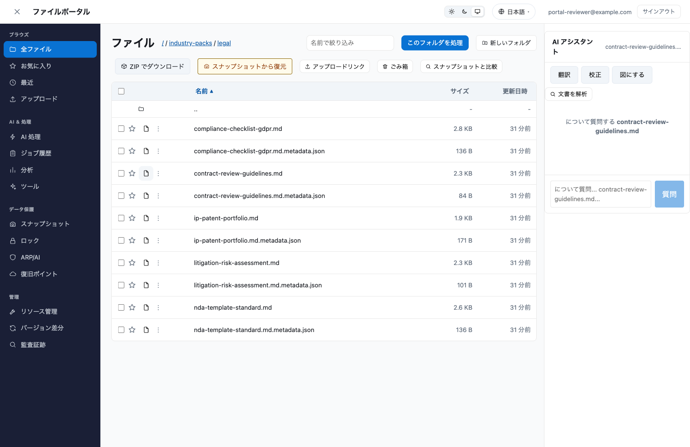
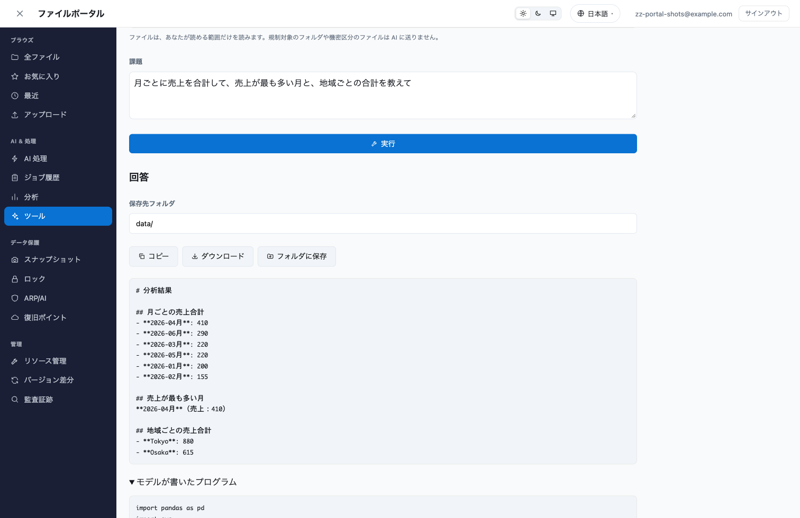
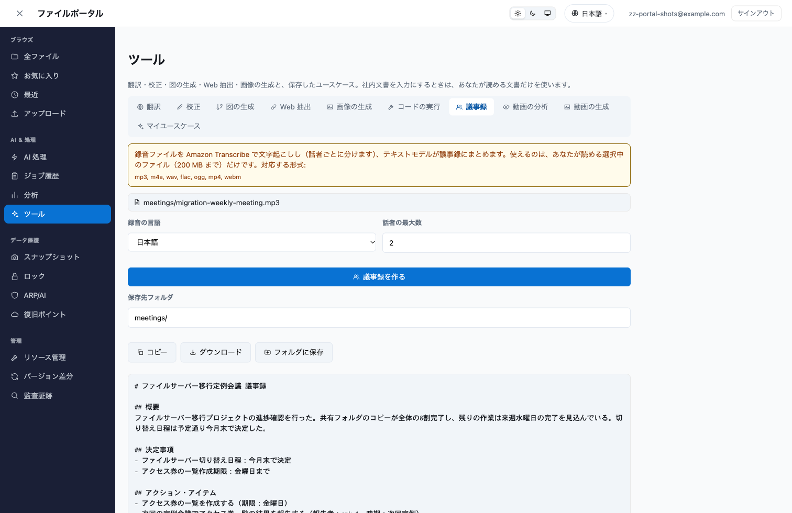
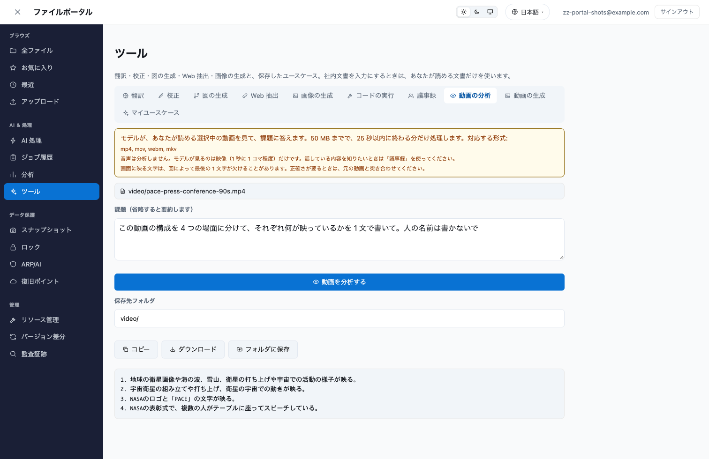
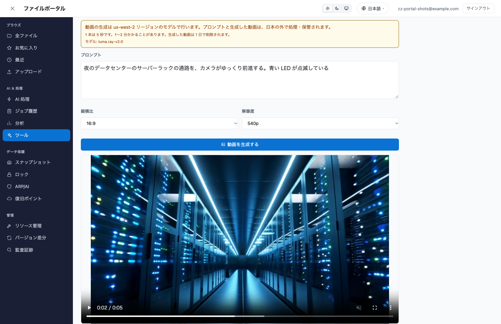

# ファイルポータルのツール

🌐 **Language / 言語**: 日本語 | [English](file-tools.en.md)

サイドバーの「ツール」で、FSx for ONTAP 上のファイルに対して翻訳・校正・図の生成をし、Web ページを要約し、画像を作ってフォルダに保存し、よく使う指示をテンプレートとして保存できます。ファイルの一覧でファイルを選ぶと、右の AI パネルに「翻訳・校正・図にする」のボタンが出て、そのファイルを入力にしてツールを開けます。スクリーンショットは、デプロイした Amplify sandbox（ap-northeast-1、2026-11-15）で撮りました。

## 各ツールの動作

| ツール | 入力 | 結果 |
|--------|------|------|
| 翻訳 | 選択中のファイル、または貼り付けたテキスト | 13 言語へ翻訳。文体と用語の補足を指定できる。結果はコピー、ダウンロード、フォルダへの保存（`<名前>.<言語>.md`） |
| 校正 | 同上 | 指摘（元の表記・修正案・理由）と、直した全文 |
| 図の生成 | 同上 | フローチャートなど 9 種類の図を Mermaid で描く。SVG のダウンロードと、`.mmd` のフォルダへの保存 |
| Web 抽出 | URL | 要約、本文の抽出、質問への回答 |
| 画像の生成 | プロンプト | 画像を作り、保存先フォルダに PNG で保存する。既定で無効 |
| コードの実行 | 選択中のファイル、またはテキストと、課題 | モデルが Python のプログラムを書き、ネットワークのないサンドボックスで実行して、出力から答える。回答、プログラム、各回の成否と出力を表示する。既定で無効 |
| 動画の分析 | 選択中の動画（mp4、mov、webm、mkv）と課題 | Nova 2 Lite が動画を見て課題に答える（省略すると要約）。1 回の呼び出しで答えるので、50 MB を超える動画は拒否する。既定で無効 |
| 動画の生成 | プロンプト | Luma Ray v2 が 5 秒の動画を作り、10 分間有効なリンクで再生・ダウンロードする。モデルは us-west-2 だけにあり、プロンプトと動画は日本の外で処理・保管される。既定で無効 |
| 議事録 | 選択中の録音ファイル | Amazon Transcribe で話者ごとに文字起こしし、テキストモデルが、選んだ形式（議事録、原文に近い文字起こし、記事、FAQ）にまとめる。既定で無効 |
| マイユースケース | 選択中のファイル、またはテキスト | 保存したテンプレートの `{{input}}` に入力を入れて実行する |

次の 4 枚は、2026-11-17 に同じ sandbox で、使い捨てのアクセスポイントに置いたサンプルデータを入力にして撮りました。CSV は 12 行の架空の売上、録音は Amazon Polly の日本語の声 2 つで作った架空の会議（約 41 秒）、動画は NASA の記者会見（[PACE Prelaunch News Conference](https://images.nasa.gov/details/PACE%20Prelaunch%20News%20Conference)）の冒頭 90 秒です。結果はどれも 1 回分で、手を加えていません。

## ファイルの読み書きと権限

- **ファイルを読むとき**: `functions/file-tools` は、ファイルの質問（`ask-about-file`）と同じ順で確かめます。外部の利用者の AI 利用、パスの境界（`scope_for_caller`）、規制対象のフォルダ（`/dicom/`、`/phi/`、`/pii/`）、データの機密区分の順です。境界の外のファイルは、何かを読む前に拒否します。読むのは先頭の 100 KB までです
- **書き込むとき**: フォルダへの保存（翻訳などの結果、画像）は `toolsMutation` を通ります。ロールを強制しているときは、書き込みロール（contributor、storage-admin）だけが使えます。リゾルバーが `writeOperation` を設定するので、`toolsQuery` から書き込むことはできません。同じ名前のファイルは上書きせず、`-1` などを付けます
- **ユースケースを保存するとき**: ユースケースの保存・削除は `toolsUseCaseMutation` を通ります。ユースケースは利用者本人のプロンプトのひな形で、専用の DynamoDB テーブルに利用者 ID ごとに入り、ファイルシステムには何も書きません。そのため、ロールを強制しているときも、ポータルのロール（viewer、contributor、storage-admin、auditor）をどれか持っていれば使えます。どのグループにも入っていないアカウントは使えません。このリゾルバーは `useCaseOperation` だけを設定するので、`toolsUseCaseMutation` からフォルダへ書き込むことはできません <!-- allow:not-a-claim: describes what this app permits, not a vendor limit -->
- **閲覧ロール**: 翻訳・校正・図の生成・Web 抽出と、ユースケースの作成・実行・削除ができます。フォルダへの保存はできません
- **Web 抽出**: ページは Lambda から取得します。公開されていないアドレス（プライベート、リンクローカル、メタデータの `169.254.169.254`、IPv6 のユニークローカル、IPv4 射影形式）に解決されるホスト、既定以外のポート、認証情報付きの URL は拒否します。接続は確かめたアドレスに固定し、リダイレクトは 1 段ごとに確かめ直します <!-- allow:not-a-claim: describes what this app refuses, not a vendor limit -->

## コードの実行
有効にすると「コードの実行」のタブが出ます。課題（例: 売上の列を月ごとに合計して、最も多い月を教える）と入力を渡すと、`functions/file-tools` の action `code` が次の順で動きます。

1. ファイルの境界を確かめます（`read_file_text`。ファイルの質問と同じ検査）。読めない、または分類で AI が使えないファイルは、モデルにもサンドボックスにも渡さず、ここで止まります。
2. モデルが Python のプログラムを書きます。モデルのプロンプトに入るのは課題、サンドボックス内の固定名（`doc1.txt`、文字を入力したときは `input.txt`）、元の拡張子だけで、ファイルの本文と元の名前は入りません。
3. AgentCore の組み込み Code Interpreter（`aws.codeinterpreter.v1`）にセッションを開き、入力を書き込み、プログラムを実行し、セッションを止めます。時間切れのときも止めます。
4. 失敗したら、プログラムとエラー（3,000 文字まで）を渡してモデルに直させます。出力は 6,000 文字までです。エラーと出力は `<input>` で包み、中の指示に従わないよう system に書いています。
5. 成功した出力から、モデルが回答を書きます。

| 上限 | 値 | 理由 |
|---|---|---|
| 1 リクエスト全体 | 25 秒 | AppSync のリゾルバーは応答を 30 秒までしか待たない。Lambda のタイムアウトを延ばしても、AppSync が先に切る |
| 実行 1 回 | 12 秒 | 最初の実行は `min(12 秒, 25 秒 − 経過 − 5 秒)`。5 秒は回答を書くための予約。残りが 3 秒未満なら実行しない |
| 実行回数 | 最大 2 回 | 2 回目は、1 回目の失敗が早く返ったときだけ時間に収まる。収まらない課題は「時間内に終わらなかった」と返す |

サンドボックスにはネットワークがなく、入るのはあなたが読める選択中のファイル（100 KB まで）または入力した文字だけです。閲覧ロールでも使えます。読み取りだけで、フォルダには書き込まないため、`toolsQuery` と同じ権限です（結果の保存は他のツールと同じく書き込みロールだけ）。Lambda のロールに足す権限は、`bedrock-agentcore:StartCodeInterpreterSession`、`InvokeCodeInterpreter`、`StopCodeInterpreterSession` の 3 つで、リソースは `arn:aws:bedrock-agentcore:<リージョン>:aws:code-interpreter/aws.codeinterpreter.v1` に限ります（アカウント部分は文字どおり `aws`）。

## 議事録
有効にすると「議事録」のタブが出ます。ファイルの一覧で録音ファイル（mp3、m4a、wav、flac、ogg、mp4、webm。200 MB まで）を選び、録音の言語（ja-JP、en-US、ko-KR、zh-CN、fr-FR、de-DE、es-ES）と話者の最大数（2〜10）と出力の形式を指定します。

Transcribe は数分かかり、AppSync のリゾルバーは 30 秒までしか待たないので、`functions/file-tools` の action を 2 つに分けています。

1. `minutes-start`: ファイルの境界を確かめ（`read_file_text` と同じ検査。読めない、分類で AI が使えない、規制対象のフォルダのファイルはここで止まる）、拡張子とサイズを確かめてから、Transcribe のジョブを作ります。入力は `s3://<アクセスポイントのエイリアス>/<キー>` で直接渡すので、ブラウザからのアップロードもステージング用のバケットもありません。ジョブ名は `portal-minutes-<利用者 ID のハッシュ 24 桁>-<uuid>` です。
2. `minutes-status`: 画面が 5 秒おきに呼びます（最長 30 分）。ジョブ名が呼び出した利用者のハッシュを含まないものは「見つかりません」を返し、Transcribe にも問い合わせません。完了したら、Transcribe が返した出力先がその利用者のフォルダであることを確かめてから読み、`spk_0: …` の行（同じ話者の連続は 1 行）にして、テキストモデルに渡します。状態は Transcribe のジョブが持つので、DynamoDB のテーブルはありません。

出力の形式は 4 つです。`minutes`（既定。要約、決定事項、アクション項目、議論の要点）、`transcript`（原文に近い文字起こし。話者の発言を順に残し、言いよどみと繰り返しだけを除く）、`article`（見出し、リード、本文の記事）、`faq`（会議で出た問いと、欠席した人が聞きそうな問いに、文字起こしだけから答える）。形式は `minutes-status` の `style` で渡します。文字起こしは出力先のバケットに 1 日残るので、終わったジョブを別の形式で作り直すときは、Transcribe を呼ばずに `minutes-status` だけを呼びます（画面の「この形式で作り直す」）。どの形式でも、書かれていない担当者・期限・名前・数値を作らせず、見出しを録音の言語にします。文字起こしは `<input>` で包み、中の指示に従わないよう system に書いています。30,000 文字を超える文字起こしは前半だけを使い、画面に表示します。

Transcribe の出力先は、アクセスポイントではなく専用の通常の S3 バケット（`MinutesTranscriptBucket`。非公開、暗号化、1 日で削除）です。Lambda のロールに足す権限は、`transcribe:StartTranscriptionJob` と `GetTranscriptionJob`（`transcription-job/portal-minutes-*` に限る）と、そのバケットの `transcripts/*` への `s3:PutObject`、`s3:GetObject` です。Transcribe は呼び出し側の権限で入力を読み、出力を書くので、アクセスポイントの読み取りは既存の権限を使います。閲覧ロールでも使えます。利用者のフォルダには書き込まないため、`toolsQuery` と同じ権限です。

## 動画の分析
有効にすると「動画の分析」のタブが出ます。動画（mp4、mov、webm、mkv）を選び、課題を入力します（省略すると要約します）。モデルは `jp.amazon.nova-2-lite-v1:0` で、動画は Bedrock Converse の `video` ブロックに `s3://<アクセスポイントのエイリアス>/<キー>` で直接渡します。アップロードもステージング用のバケットもありません。ファイルの検査（境界、規制対象のフォルダ、分類、外部の利用者）、拡張子、サイズは議事録と同じ順で、モデルを呼ぶ前に行います。動画の中の文字や音声は「報告する内容」で、モデルへの指示ではないと system に書いています。

AppSync は 30 秒までしか待たないので、**1 回の呼び出し（`video`）を 25 秒以内に収め、収まらない大きさのファイルだけを拒否します。** モデルの呼び出しには読み取りの待ち時間 20 秒を付け、全体は 25 秒で打ち切ります。どちらも「時間内に終わらなかった」と返します。サイズの上限は `VIDEO_ANALYSIS_MAX_MB`（既定 50）で、超えた動画は、モデルを呼ぶ前に `file too large for synchronous analysis (limit N MB)` で拒否します。上限の根拠は、下の「動画の分析の確認結果」の測定です。収まらない動画のための非同期の経路は、実用に足りないと分かったときに別の変更で足します。

**音声は分析しません。** Nova 2 Lite の動画の理解は映像のフレーム（16 分以下の動画では 1 秒に 1 コマ）だけを使い、音声トラックは処理しません（[Amazon Nova 2 のマルチモーダルの理解](https://docs.aws.amazon.com/nova/latest/nova2-userguide/using-multimodal-models.html)の「No audio support」）。話の内容が要るときは「議事録」を使います。話の内容を作って答えるのを防ぐため、動画を呼ぶ前にテキストモデル（`TOOLS_MODEL_ID`）に「この課題には音声が要るか」を判定させ、要るときだけ、課題の前に「音声はあなたに渡されていない。最初に音声を分析していないと書き、映像から分かることだけを答える」という注意を入れます。要らない課題（画面の文字、人数、動作など）には入れません。この注意を常に入れると、画面の文字の書き出しまで断るようになったためです。判定に失敗したときは、注意を入れる側に倒します。画面は、上限と、音声を分析しないこと、「画面に映る文字は、回によって最後の 1 文字が欠けることがある。正確さが要るときは元の動画と突き合わせる」を表示します。Lambda のロールに足す権限は、Nova 2 Lite の推論プロファイルと東京・大阪の基盤モデルへの `bedrock:InvokeModel` だけです。動画の読み取りは既存のアクセスポイントの権限を使います。閲覧ロールでも使えます。利用者のフォルダには書き込みません。

## 動画の生成
有効にすると「動画の生成」のタブが出ます。プロンプトを入力し、縦横比（16:9、9:16）と解像度（540p、720p）を選ぶと、`luma.ray-v2:0` が 5 秒の動画を作ります。**このモデルは us-west-2 だけにあり（2026-11-16 に `list-foundation-models` で確かめた 12 リージョンのうち us-west-2 だけ）、プロンプトと生成した動画は日本の外で処理・保管されます。** 画面は、何かを送る前にこれを表示します（画像の生成と同じ型）。許可する値は、実際に動かした値だけです。プロンプトの上限 2,000 文字は、このツール側の上限です。

生成には 36〜74 秒かかり、AppSync の 30 秒に収まらないので、`video-generate-start` と `video-generate-status` に分けています。

1. `video-generate-start`: Bedrock Runtime（us-west-2）の `StartAsyncInvoke` を呼びます。出力先は `s3://<出力バケット>/videos/<利用者 ID のハッシュ>/<uuid>/` です。同時に複数を始めて `ThrottlingException` になったときは、「混み合っています」を返します。
2. `video-generate-status`: 画面が 5 秒おきに呼びます。クライアントが送る `invocationArn` は、形（リージョンとアカウントの 12 桁）を確かめたうえで `GetAsyncInvoke` に渡し、サービスが返した出力先が呼び出した利用者のフォルダ（`videos/<ハッシュ>/`）でなければ「見つかりません」を返します。完了していれば、`output.mp4` への署名付き URL（10 分）を返します。

出力バケットは、**既存のバケットを指定します**。Amplify のスタックは 1 つのリージョンにしか作れず、バケットはモデルと同じリージョンに要るため、ポータルの CDK では作りません。`infrastructure/video-output-bucket.yaml` を us-west-2 にデプロイし、出力の `BucketName` を `tools.videoGeneration.outputBucket`（または `AMPLIFY_PORTAL_VIDEO_GENERATION_BUCKET`）に入れます。非公開、暗号化、TLS 必須、1 日で削除のバケットです。有効にして `outputBucket` を空にすると、デプロイが「`tools.videoGeneration.outputBucket` が必要」というメッセージで止まります。

Lambda のロールに足す権限は、モデルへの `bedrock:InvokeModel` と `StartAsyncInvoke`、アカウントの `async-invoke/*` への `bedrock:InvokeModel` と `GetAsyncInvoke`、出力バケットの `videos/*` への `s3:PutObject` と `s3:GetObject` です。署名付き URL は、出力バケットのあるリージョンのエンドポイントで署名します。閲覧ロールでも使えます。利用者のフォルダには書き込みません。

## 設定

`amplify/portal-config.ts` の `tools`、または環境変数で決めます。既存の `portal-config.ts` に `tools` が無くても、環境変数が使われます。

| 環境変数 | 既定 | 内容 |
|----------|------|------|
| `AMPLIFY_PORTAL_IMAGE_GENERATION_ENABLED` | `false` | 画像の生成 |
| `AMPLIFY_PORTAL_IMAGE_GENERATION_REGION` | `us-west-2` | 画像のモデルを呼ぶリージョン |
| `AMPLIFY_PORTAL_IMAGE_GENERATION_MODEL_ID` | `stability.stable-image-core-v1:1` | 画像のモデル。推論プロファイル（`us.` など）も指定でき、IAM はそれに合わせて作られる |
| `AMPLIFY_PORTAL_WEB_EXTRACT_ENABLED` | `true` | Web 抽出 |
| `AMPLIFY_PORTAL_VIDEO_GENERATION_ENABLED` | `false` | 動画の生成。`portal-config.ts` では `tools.videoGeneration.enabled` |
| `AMPLIFY_PORTAL_VIDEO_GENERATION_BUCKET` | なし | 動画の出力先の既存バケット（モデルと同じリージョン）。有効にするときは必須 |
| `AMPLIFY_PORTAL_VIDEO_GENERATION_REGION` | `us-west-2` | 動画のモデルを呼ぶリージョン |
| `AMPLIFY_PORTAL_VIDEO_ANALYSIS_ENABLED` | `false` | 動画の分析。`portal-config.ts` では `tools.videoAnalysis.enabled` |
| `AMPLIFY_PORTAL_VIDEO_ANALYSIS_MAX_MB` | `50` | 動画の分析で受け付ける最大のサイズ（1〜200）。測定した値が既定。`tools.videoAnalysis.maxMegabytes` |
| `AMPLIFY_PORTAL_MINUTES_ENABLED` | `false` | 議事録。`portal-config.ts` では `tools.minutes`。`true` のときだけ、文字起こしの出力バケット、Transcribe の権限、画面のタブが入る |
| `AMPLIFY_PORTAL_CODE_EXECUTION_ENABLED` | `false` | コードの実行。`portal-config.ts` では `tools.codeExecution`。`true` のときだけ、Lambda の `CODE_INTERPRETER_ENABLED` と IAM、画面のタブが入る |

**[verified 2026-11-14 / ap-northeast-1、us-west-2 ほか 12 リージョン]** 東京リージョンには画像を出力するモデルがありません。 [E-019]テキストから画像を作るモデル（Stable Image Core / Ultra、SD3.5 Large）は、確かめた 14 リージョンのうち us-west-2 だけにあり、推論プロファイルはありません。このため既定は us-west-2 で、プロンプトと画像は日本の外で処理されます。画面にもそう表示します。テキストのツールは `jp.anthropic.claude-haiku-4-5-20251001-v1:0`（東京と大阪で処理）を使います。

## 確認結果

**[verified 2026-11-15 / ap-northeast-1]** Amplify sandbox で、storage-admin の利用者が `industry-packs/legal/` のファイルに対して確かめました。所要時間は 1 回ずつの観測値です。

| 確認したこと | 結果 |
|---|---|
| 選択中のファイルの英訳 | 6.7 秒。フォルダへの保存を 2 回行い、2 回目は上書きせず `contract-review-guidelines.md.en-1.md` になった |
| 図の生成（フローチャート） | 画面に描いた |
| 画像の生成（16:9） | 保存先フォルダに `contract-review-illustration.png` が保存され、ファイル一覧に出た |
| ユースケースの保存と、選択中のファイルでの実行 | 成功 |
| Web 抽出（公開ページ） | 4.8 秒 |
| Web 抽出のメタデータ URL | アプリ側で拒否（`the host resolves to an address that is not allowed`）。ポータルは AppSync 経由なので、手前に WAF はない |

**範囲**: 1 人の利用者（storage-admin）で確かめました。パスの境界、閲覧ロールの書き込み拒否、規制対象のフォルダの拒否は、`functions/file-tools/tests/` と `tests/components/FileTools.test.tsx` のテストで確かめていて、実機では確かめていません。

**この確認で見つかって直した不具合**: フォルダへの保存が 403 で失敗しました。Lambda のロールに `s3:ListBucket` が無いと、S3 は存在しないキーの HeadObject にも 404 ではなく 403 を返すため [E-020]、「名前が空いている」と「拒否された」を区別できませんでした。ロールに `s3:ListBucket` を足して直しました。403 を「空いている」とみなす直し方は、拒否を見落とすので採っていません。

## コードの実行の確認結果
**確認したこと（自動テスト）**: `functions/file-tools/tests/test_file_tools.py` と `tests/components/FileTools.test.tsx`。サンドボックスとモデルはスタブです。

- 設定が `true` でなければ動かず、サンドボックスもモデルも呼ばない
- 読めないファイルの名前も本文も、モデルとサンドボックスに渡らない。分類で AI が使えないファイルは入らない。外部の利用者は拒否される
- ファイルの本文は `doc1.txt`（文字入力は `input.txt`）としてサンドボックスにだけ入り、モデルのプロンプトには入らない
- 失敗が続いても 2 回で止まる。エラーは 3,000 文字、出力は 6,000 文字で切り、`<input>` で包んで渡す
- 時間が足りなければ次の実行を始めない（モデルが 9 秒かかると 2 回目は始まらない。20 秒かかると 1 回も始まらない）
- 時間切れでも、時間切れの後にセッションが開いた場合でも、セッションを止める
- 画面は、有効なときだけタブを出し、上限を表示し、ファイルのキーと課題だけを `toolsQuery` で送る

**実機での確認（2026-11-15/16、ap-northeast-1）**: 既存の Amplify sandbox に `AMPLIFY_PORTAL_CODE_EXECUTION_ENABLED=true` を付けてデプロイしました。AppSync の呼び出しは、サインインしたブラウザのトークンで行いました。所要時間は 1 回ずつの観測値です。

| 確認したこと | 結果 |
|---|---|
| storage-admin の利用者が、アクセスポイント上の CSV を入力に、売上の合計と最大の月を聞く | 合計 965、最大は 4 月（410）。AppSync の応答まで 6.3 秒。プログラムは 1 回で成功 |
| `time.sleep(120)` を求める課題（25 秒の枠） | 1 回目が時間切れ、2 回目が成功。全体 18.0 秒で返り、AppSync の 30 秒に収まった |
| internal グループだけの利用者が、許可外のキーを指定 | `key is outside the prefixes your groups may access` で 0.18 秒で拒否 |
| 同じ利用者が、許可内のキーを指定 | 実行できた |
| 同じ利用者が、機密の行（`SECRETSALARY`）を含むファイルを指定 | 拒否された。その利用者への応答のどこにも、機密の行は現れなかった |
| 画面 | 「コードの実行」タブ、環境の説明（Python 3.12、pandas と numpy、1 リクエスト最大 2 回、1 回 12 秒、全体 25 秒）、文字入力での実行、回答の表示 |

**確認していないこと**: 25 秒に近い最悪の場合（モデルがプログラムを書くのに長くかかったうえで、1 回目が時間切れになるなど）。上の 18.0 秒は 1 つの観測で、上限ではありません。回答まで写したスクリーンショットも未取得です（実行前の入力画面だけを撮っていて、このドキュメントには載せていません）。サンドボックスが aarch64 であることと、最小権限のロールで開始・実行・停止できることは、別のプロジェクト（RAG アプリ、ap-northeast-1、2026-11-15）の確認で、このポータルのテストと実機の確認では直接見ていません。

**確認で分かったこと**: sandbox の `S3AP_ALIAS` が指していたアクセスポイントが、すでに存在しませんでした。今回は使い捨てのボリュームとアクセスポイントを作って差し替えて確認し、確認後に元の値へ戻しました。実機のデプロイは、git で管理しない設定ファイルの 6 つの値（アクセスポイント、ONTAP の接続、VPC など）が空だと止まります。これは意図した保護です。sandbox を引き継ぐときは、設定値のアクセスポイントが実在するかを先に確かめてください。 <!-- allow:not-a-claim: describes this portal's deploy guard and a deleted access point in our own sandbox, not a vendor limit -->

## 議事録の確認結果
**確認したこと（自動テスト）**: `functions/file-tools/tests/test_file_tools.py` と `tests/components/FileTools.test.tsx`。Transcribe、S3、モデルはスタブです。

- 設定が `true` でなければ動かず、Transcribe を呼ばない
- 読めないファイル、分類で AI が使えないファイル、外部の利用者は、ジョブを作らない（読めないファイルは `head_object` もしない）
- 許可リスト外の拡張子、200 MB を超えるファイル、許可外の言語、範囲外の話者数を拒否する
- ジョブ名に利用者 ID のハッシュが入り（ID そのものは入らない）、入力はエイリアスの `s3://` URI、出力は `transcripts/<ハッシュ>/` になる
- 他の利用者のジョブ名と、このツールが作っていない名前は「見つかりません」になり、Transcribe を呼ばない
- Transcribe が返した出力先が利用者のフォルダでなければ、読まない
- 文字起こしは `<input>` で包まれ、同じ話者の連続は 1 行にまとまる。長い文字起こしは前半だけになり、`truncated` を返す
- 画面は、有効なときだけタブを出し、ファイルのキーだけを送り、5 秒おきに状態を確かめ、完了で議事録を表示し、失敗の理由を表示する

**実機での確認（2026-11-16、ap-northeast-1）**: 使い捨てのボリューム、アクセスポイント、出力バケットを作り、`functions/file-tools/index.py` のハンドラーを、実際の Transcribe、S3 アクセスポイント、Bedrock に対して手元から直接呼びました。AppSync と Cognito は通していません。録音は、Polly の日本語の声 2 つで作った約 17 秒（141 KB）の mp3 です。所要時間は 1 回ずつの観測値です。

| 確認したこと | 結果 |
|---|---|
| エイリアスの `s3://` URI を Transcribe が読む | 読めた。ジョブは約 11 秒で完了し、出力はバケットの `transcripts/<ハッシュ>/` に入った |
| キーに空白と日本語を含む（`minutes/会議 録音.mp3`） | 同じく完了した |
| `minutes-start` の所要時間（`head_object` とジョブの作成を含む） | 1.9 秒 |
| `minutes-status` の所要時間（出力の読み取りとモデル 1 回を含む） | 2.0 秒 |
| 議事録 | 概要、決定事項（12 月 5 日のリリース）、アクション項目、議論の要点が出た。実施時期は「明記されていない」と書かれた |
| グループ `team-b` の利用者が `minutes/` のキーを指定 / `team-a` の利用者が許可外の `other/` のキーを指定 | どちらも `key is outside the prefixes your groups may access` で拒否（0.0 秒）。ジョブは作られない |
| 許可リスト外の拡張子（`.pdf`） | 拒否された |
| 別の利用者が、他人のジョブ名を `minutes-status` に渡す | `job not found`。Transcribe には問い合わせない |
| `audio_segments` の形 | `speaker_label` と `transcript` を持つ。想定どおり |
| 使い捨ての Lambda（このリポジトリの `index.py` と `shared/`、CDK と同じ最小権限のロール）に、AppSync が送る形のイベントを直接送る | `minutes-start` 1.6 秒、開始から完了まで約 15 秒、議事録が返った。他の利用者は `job not found`。ロールの Transcribe と S3 の権限は足りていた |

**AppSync、Cognito、画面、CDK を通した確認（2026-11-16、ap-northeast-1）**: この変更を含むブランチを、既存の Amplify sandbox に `AMPLIFY_PORTAL_MINUTES_ENABLED=true` でデプロイし（CDK、約 160 秒）、使い捨ての Cognito 利用者 2 人（`viewer` と `auditor`。どちらも `internal`）でサインインしました。アクセスポイントは使い捨てのボリューム上のもので、許可するプレフィックスは `viewer` が `minutes/` と `video/`、`auditor` が `other/` です。画面は `npm run dev` で開き、AppSync への直接の呼び出しはサインインしたブラウザのトークンで行いました。

| 確認したこと | 結果 |
|---|---|
| `viewer` の利用者がファイルの一覧を開く | `minutes` と `video` だけが見え、`other` は見えない |
| 同じ利用者が `minutes/meeting.mp3` を選び、「議事録」のタブで「議事録を作る」 | 21 秒で議事録が画面に出た。閲覧ロール（書き込みなし）で使えた。CDK が作った出力バケットと IAM のロールで動いた |
| `auditor` の利用者が `minutes/meeting.mp3` で `minutes-start` を AppSync に送る | `key is outside the prefixes your groups may access` |
| 同じ利用者が、`viewer` の利用者のジョブ名で `minutes-status` を送る | `job not found` |
| 同じ利用者が、許可内の `other/board.mp3` で `minutes-start` を送る | ジョブが始まった |

**実際の録音での確認（2026-11-16、ap-northeast-1）**: NASA の記者会見（[PACE Prelaunch News Conference](https://images.nasa.gov/details/PACE%20Prelaunch%20News%20Conference)）の質疑の 10 分を英語の mp3（64 kbps、4.6 MB）にして、ハンドラーを手元から実際の Transcribe とアクセスポイントと Bedrock に対して呼びました。`en-US`、話者の最大数 6 で 1 回です。

| 確認したこと | 結果 |
|---|---|
| 所要時間 | `minutes-start` 1.8 秒。開始から議事録まで約 79 秒（10 秒おきに状態を確認） |
| 話者の分離 | 3 人に分かれた（`spk_0` 26 区間、`spk_1` 15 区間、`spk_2` 4 区間、合わせて 45 区間）。文字起こしを読んだ範囲では、`spk_0` が答える科学者、`spk_1` が質問を読み上げる司会、`spk_2` が電話で質問した記者で、話の切り替わりと一致した |
| 議事録 | 要約と議論の要点（植物プランクトン、エアロゾル、設計寿命 3 年と燃料 10 年分など）は文字起こしの内容と一致した。決定事項とアクション項目は「記録されていない」と書き、担当者や期限を作らなかった |

**日本語の実際の録音での確認（2026-11-17、ap-northeast-1）**: 首相官邸が公開している[内閣官房長官記者会見（令和 8 年 11 月 13 日午前）](https://www.kantei.go.jp/jp/tyoukanpress/202611/13_a.html)の音声 11 分 27 秒（mp3、64 kbps、5.2 MB）で、`ja-JP`、話者の最大数 6 で 1 回実行しました。冒頭の発表と、記者 4 人ほどとの質疑を含みます。

| 確認したこと | 結果 |
|---|---|
| 所要時間 | 開始から議事録まで約 181 秒 |
| 文字起こしの正確さ | 冒頭の発表（約 4 分 30 秒）を、同じページの公式の書き起こし（1,344 文字）と比べた文字の誤り率は約 7.8%。「御」と「ご」、「及び」と「および」のような表記の違いも誤りに数えているので、上限の目安。人名と社名の誤りがあった（「高市」が「高橋」や「タカ市」、「カスト」が「勝人」、NVIDIA が「NPDI」） |
| 話者の分離 | 5 人に分かれた。発表と答えはすべて同じ 1 人（49 区間のうち 40）にまとまった。記者は社名を名乗る区間ごとに別の話者になったが、司会の「どうぞ」が記者と同じ話者や同じ区間にまとまった箇所があった |
| 議事録 | 金額（6,519 億円、5,219 億円、1,300 億円）と日程（11 月 16〜19 日、19〜21 日、19〜20 日）は公式の書き起こしと一致した。文字起こしの「NPDI」は、議事録では「NVIDIA」に直っていた。担当者と期限は「不明」と書き、作らなかった |

**正解の話者ラベルとの照合（2026-11-17）**: [AMI Meeting Corpus](https://groups.inf.ed.ac.uk/ami/corpus/)（CC BY 4.0）の会議 ES2004a（英語、4 人、17 分 29 秒）の混合音声と、[pyannote の AMI 用の話者ラベル](https://github.com/pyannote/AMI-diarization-setup)で照合しました。10 ミリ秒ごとに、1 人だけが話している区間（663 秒）の話者が、最もよく対応する Transcribe の話者と一致した割合を数えました。

| 話者の最大数 | 見つかった話者 | 一致した割合 | Transcribe が話者を付けなかった割合 | 所要時間 |
|---|---|---|---|---|
| 4 | 4 | 86.9% | 10.9% | 約 212 秒 |
| 10 | 4 | 86.9% | 10.9% | 約 200 秒 |

残りの約 2% が別の人に割り当てられた区間です。2 人以上が同時に話す区間（124 秒）は数えていません。話者の最大数を 4 にしても 10 にしても、結果は同じでした。

**日本語の、発言が短く交互に続く録音での確認（2026-11-17）**: 首相官邸が公開した[党首討論（平成 22 年 4 月 21 日、国家基本政策委員会合同審査会）の動画](https://commons.wikimedia.org/wiki/File:%E7%B7%8F%E7%90%86%E3%81%AE%E5%8B%95%E3%81%8D-%E5%9B%BD%E5%AE%B6%E5%9F%BA%E6%9C%AC%E6%94%BF%E7%AD%96%E5%A7%94%E5%93%A1%E4%BC%9A%E5%90%88%E5%90%8C%E5%AF%A9%E6%9F%BB%E4%BC%9A%EF%BC%88%E5%85%9A%E9%A6%96%E8%A8%8E%E8%AB%96%EF%BC%89-%E5%B9%B3%E6%88%9022%E5%B9%B44%E6%9C%8821%E6%97%A5.webm)（Wikimedia Commons、CC BY 3.0、51 分 27 秒）の音声で、`ja-JP` で実行しました。発言者は 4 人（会長、総理、2 人の党首）で、51 発言のなかには会長の「ちょっとお待ちください」のような短い割り込みも含まれます。正解は、[国会会議録検索システムの API](https://kokkai.ndl.go.jp/api.html) から取った同じ会議の会議録（発言者つき）です。会議録には時刻がないので、会議録の文字と文字起こしの文字を突き合わせ（言いよどみと句読点を除く）、対応した文字の話者が一致する割合を数えました。

| 話者の最大数 | 見つかった話者 | 会議録の文字のうち対応した割合 | 対応した文字の話者が一致した割合 | 所要時間 |
|---|---|---|---|---|
| 4 | 4 | 95.0%（13,756 文字のうち 13,064） | 99.9% | 約 312 秒 |
| 10 | 4 | 95.0% | 99.9% | 約 296 秒 |

話者ごとの一致は、会長 99.2%、総理 100%、2 人の党首 99.8% と 99.9% でした。議事録は議題と論点（普天間の移設、核セキュリティ・サミット、政治資金）を会議録どおりにまとめ、決定事項とアクション項目は「記録なし」と書きました。人名は 2 人の党首の名前を聞き違え、その誤りが議事録にもそのまま残りました。

**読み取りの限界**: これは会長が指名して 1 人ずつ話す形式で、同時に話す区間はほとんどありません。複数人が同時に話す社内の打ち合わせのような録音では、AMI（上）で 2 人以上が同時に話す区間を数えなかったのと同じく、確かめていません。条件に合う公開データが見つかっていないため、今後の課題にしています（[#552](https://github.com/Yoshiki0705/FSx-for-ONTAP-S3AccessPoints-Serverless-Patterns/issues/552)）。 <!-- allow:not-a-claim: our own measurement on open data -->

**出力の形式の確認（2026-11-17、ap-northeast-1）**: 3 つの変更（出力の形式、ユースケースの共有、回答の評価）をまとめたツリーを、既存の Amplify sandbox に `AMPLIFY_PORTAL_MINUTES_ENABLED=true` でデプロイし、使い捨てのアクセスポイントに置いた Polly の架空の会議（約 41 秒、日本語の声 2 つ）で、画面から 1 回ずつ確かめました。

| 確かめたこと | 結果 |
|---|---|
| `faq` で作る | 会議で出た問い 4 つに答えた。開始から結果まで 19.6 秒 |
| 同じジョブを `article`、`transcript`、`minutes` で作り直す | それぞれ 8.5 秒、7.9 秒、8.8 秒。Transcribe のジョブは最初の 1 つのまま増えなかった（`list-transcription-jobs` で確認） |
| `transcript` が言葉を変えないか | 「移行」の誤認識「以降」も、そのまま残した。話者の区切りは Transcribe の判定どおりで、最初の 2 人分の発言が `spk_0` の 1 行にまとまった |
| `minutes` の担当者 | 文字起こしに無い担当者は「不明」と書いた |

## 動画の分析の確認結果
**確認したこと（自動テスト）**: `functions/file-tools/tests/test_file_tools.py` と `tests/components/FileTools.test.tsx`。モデルと S3 はスタブです。

- 設定が `false` なら動かず、モデルを呼ばない。外部の利用者は拒否される
- Bedrock に渡るのはアクセスポイントのエイリアスの URI で、system にファイル名は入らない。課題は `<input>` で包まれる
- 読めない動画、分類で AI が使えない動画、許可リスト外の拡張子、上限を超える動画は、モデルを呼ばない。上限の超過は上限の値を含むメッセージで拒否する。上限は設定で変えられる
- 25 秒を超える呼び出しと、モデル呼び出しの読み取りタイムアウトは、どちらも「時間内に終わらなかった」と返る
- 非同期の `video-start` と `video-status` は存在しない
- 画面は、有効なときだけタブを出し、上限と時間と文字の欠けの注意を表示し、ファイルのキーと課題だけを `video` で送り、拒否のメッセージを表示する

**上限の測定（2026-11-16、ap-northeast-1）**: 使い捨ての Lambda（このリポジトリの `index.py` と `shared/`、最小権限のロール、メモリ 512 MB）に、AppSync が送る形のイベントを直接送りました。動画は使い捨てのボリューム上のアクセスポイントに置いた合成動画で、モデルは `jp.amazon.nova-2-lite-v1:0`、課題は既定の「要約」です。各点を 3 回測りました。時間は Lambda の呼び出し全体の秒数です。サイズの軸は、60 秒の動画の画質（ビットレート）を変えてサイズを変えました（映像のみ）。長さの軸は、約 1.5 Mbps でテストパターンと正弦波の音声の長さを変えました。

| 軸 | 動画 | 1 回目 | 2 回目 | 3 回目 | 最も遅い値 |
|---|---|---|---|---|---|
| サイズ（60 秒） | 4 MB | 6.6 秒 | 4.9 秒 | 4.2 秒 | 6.6 秒 |
| | 15 MB | 5.5 秒 | 5.6 秒 | 6.1 秒 | 6.1 秒 |
| | 46 MB | 6.9 秒 | 7.3 秒 | 7.6 秒 | 7.6 秒 |
| | 90 MB | 8.6 秒 | 7.9 秒 | 8.1 秒 | 8.6 秒 |
| | 195 MB | 12.1 秒 | 11.1 秒 | 12.0 秒 | 12.1 秒 |
| 長さ（約 1.5 Mbps） | 10 秒（1 MB） | 4.5 秒 | 4.0 秒 | 4.8 秒 | 4.8 秒 |
| | 1 分（11 MB） | 7.4 秒 | 6.3 秒 | 5.0 秒 | 7.4 秒 |
| | 5 分（56 MB） | 18.1 秒 | 14.5 秒 | 13.5 秒 | 18.1 秒 |
| | 7 分（78 MB） | 25.7 秒（時間切れ） | 15.2 秒 | 18.9 秒 | 25.7 秒 |
| | 10 分（112 MB） | 25.1 秒（時間切れ） | 25.0 秒（時間切れ） | 25.1 秒（時間切れ） | 時間切れ |

**読み取り**: かかる時間は、サイズではなく動画の長さにほぼ比例します。60 秒の動画は、195 MB でも 12.1 秒でした。一方、同じ 112 MB でも 10 分の動画は 3 回とも時間切れで、7 分（78 MB）でも 1 回は時間切れでした。長さの軸で 25 秒に必ず収まった最大の点は 5 分（56 MB、最も遅い値が 18.1 秒）です。ファイルサイズから長さは分からないので、既定の上限は、この 5 分の点より少し下の **50 MB** にしました。約 1.5 Mbps の動画なら 4 分半ほどです。この上限には次の限界があります。

- 低いビットレートの長い動画は、50 MB に収まっても 25 秒を超えることがあります。その場合は「時間内に終わらなかった」と返ります。
- 高いビットレートの短い動画は、時間に余裕があっても（195 MB で 12 秒）50 MB を超えれば拒否されます。この場合は `VIDEO_ANALYSIS_MAX_MB` を上げてください。
- 上は 1 種類の合成動画での値です。実際の映像、他のビットレート、混み合っているときの時間は測っていません。動画の長さで拒否する検査は入れていません。必要なら、`moov` の読み取りで長さを取る検査を別の変更で足します。

**AppSync、Cognito、画面、CDK を通した確認（2026-11-16、ap-northeast-1）**: この版（同期だけ）を、既存の Amplify sandbox に `AMPLIFY_PORTAL_VIDEO_ANALYSIS_ENABLED=true` でデプロイし（CDK、約 210 秒。Lambda のタイムアウトは 30 秒、`VIDEO_ANALYSIS_MAX_MB=50`）、使い捨ての Cognito 利用者 2 人で確認しました。`viewer` は `video/`、`auditor` は `other/` だけを読めます。動画は上の測定と同じものです。

| 確認したこと | 結果 |
|---|---|
| `viewer` の利用者が、1 分・11 MB の動画を選んで「動画を分析する」 | 6.1 秒で日本語の回答が画面に出た（ボタンを押してから） |
| 同じ利用者が、60 秒・90 MB の動画を選んで実行 | 1.5 秒で `file too large for synchronous analysis (limit 50 MB)` が画面に出た |
| 同じ利用者が、5 分・56 MB の動画を AppSync に送る | 同じ拒否（56 MB は 50 MB を超える） |
| 同じ利用者が `video-start` と `video-status` を送る | `unknown action` |
| `auditor` の利用者が `video/` の動画を送る | `key is outside the prefixes your groups may access` |

**実際の映像での確認（2026-11-16、ap-northeast-1）**: NASA の記者会見の動画（[PACE Prelaunch News Conference](https://images.nasa.gov/details/PACE%20Prelaunch%20News%20Conference)、1280×720）から切り出した 2 本で、ハンドラーを手元から実際の Bedrock とアクセスポイントに対して呼びました。冒頭の 165 秒（46.7 MB、1 人が話す場面と、6 人が並ぶ場面）と、質疑の 180 秒（47.0 MB、6 人が並ぶ場面）です。同じ冒頭の 180 秒（51.0 MB）は、上限で拒否されました。各課題 1 回ずつで、所要時間は 8.6〜15.6 秒でした。

| 課題 | 結果 |
|---|---|
| 画面の文字をすべて書き出す | 冒頭の動画で `NASA / PACE / NASA / JIM FREE / NASA ASSOCIATE ADMINISTRATOR`（字幕の氏名と肩書きを含め、映っている文字と一致）。質疑の動画は `PACE` だけ（`NASA` のロゴは書き出さなかった） |
| 映っている人数と位置 | 質疑の動画は 6 人と服装を左から答え、映像と一致した。冒頭の動画は、1 回は「7 人」と書いて 6 人を並べ、別の回は 6 人と答えた |
| 要約 | 場面（記者会見、背景の衛星画像、国旗、ロゴ）は映像と一致した。話の中身は、映像からは分からない内容を作って書いた（「スピーカー 1 は〜を説明」など） |
| 話の主な内容を 3 つ（system の注意を入れる前と後で 2 回ずつ） | **4 回とも、実際の話と関係のない内容を作った**（PACE は地球観測の衛星だが、「地球外の天体の水の探査」など） |

**話の内容を作る問題への対処（2026-11-17 に変更）**: モデルは音声を受け取らないので、話の内容を聞かれると作って答えます。system に「音声は渡されないので、話の内容を書かない」と書いても止まりませんでした（4 回中 4 回）。同じ注意を利用者のメッセージに常に入れると、話の内容は作らなくなりましたが、**画面の文字の書き出しまで断る**ようになりました（2 種類の文言で 4 回中 4 回）。そこで、課題に音声が要るかをテキストモデルに先に判定させ、要るときだけ注意を入れる形にしました。

| 確認したこと | 結果 |
|---|---|
| 判定の正しさ（日本語と英語の課題 20 個） | 19 個が想定どおり。「字幕を書き起こしてください」だけを「音声が要る」と判定した（注意が入る側の誤り） |
| NASA の記者会見の質疑（上の 180 秒）で「話の主な内容を 3 つ」（2 回） | 2 回とも、話の内容を作らず「音声が無い」と書き、映像から分かること（6 人のパネル、背景）を書いた |
| 同じ動画の要約（2 回） | 最初に音声を解析できないと書き（1 回はその 1 文だけ英語だった）、映像に基づいて要約した。話の具体的な中身は作らなかった（「科学や宇宙探査に関するトピックについて議論している」程度の推測は残った） |
| 同じ動画の画面の文字（2 回） | `PACE`、`PACE / NASA`。注意は入らず、読み取りは変わらなかった |
| 判定にかかる時間 | 1 回のテキストモデル呼び出し。動画の分析全体は 9.5〜14.2 秒で、25 秒の枠に収まった |
| AppSync、Cognito、画面、CDK を通した確認（2026-11-17）。この変更を含む `main` を sandbox にデプロイし、閲覧ロールの使い捨ての利用者で、同じ動画に 3 つの課題を画面から実行 | 画面の文字は `PACE`（注意なし、13.6 秒）。話の内容は「オーディオは分析されていません」で始まり、映像から分かること（6 人のパネル、背景、身振り）だけを書いた（12.1 秒）。要約も同じ書き出しで、映像に基づいて書いた（12.1 秒）。Lambda のログに判定の失敗（`The audio check failed`）や権限の拒否はなく、判定は既存のロールの権限で動いた |

注意を入れた課題のうち、防犯カメラの映像（下の MEVA）では、要約と話の内容の課題に、モデルが「プライバシーのため応答できません」と答えました（4 回中 4 回）。話を作るよりは安全な側の失敗ですが、答えは得られません。

**話の内容についての答えは、音声を聞いたものではありません。** 画面の表示どおり、話の内容は「議事録」を使ってください。 <!-- allow:not-a-claim: our own observations of one model's replies -->

**他の種類の映像での確認（2026-11-17、ap-northeast-1）**: 各課題 1 回ずつで、所要時間は 3.6〜11.4 秒でした。

| 映像 | 課題 | 結果 |
|---|---|---|
| 日本語の記者会見（上の内閣官房長官記者会見の冒頭 120 秒、1920×1080、34.5 MB） | 画面の文字 | `今秋8年11月13日 午前 / 内閣官房長官記者会見 / ©内閣広報室`。「令和」を「今秋」と読み違えた |
| | 要約 | 手話通訳者が隣に立っていることは正しく書いた。日付を「2023年」と書き（映像には「令和8年」とだけある）、映っていない国旗や記者についても書いた |
| | 人数 | 2 人（手話通訳者と話し手）。映像と一致した |
| 作業の記録（NASA の[Mars 2020 の組み立てのタイムラプス](https://images.nasa.gov/details/JPL-20190712-M2020f-0001-PIT_CREW_FOR_MARS)、固定カメラ、77 秒、20 MB） | 画面の文字 | 英語の字幕 6 行をそのまま書き出した |
| | 要約 | 「技術者がサスペンションとテスト用の車輪を取り付けている」で、NASA の説明と一致した |
| | 人数 | 「約 20 人」と答え、各人の作業は一般論だった |
| 画面の録画（GitHub で、リポジトリ、Issues、閉じた Pull request、`file-tools.en.md` の順に開いてスクロールした 42 秒、1 秒 1 コマ） | 操作の順 | 最初の 4 つ（リポジトリ、Issues、Pull requests、ファイル）は合っていた（ファイル名は `file-tools.emd`、実在しない「Files」タブも挙げた）。その後、していない操作（「転送契約書」の行をクリック）を作り、同じ行を出力の上限まで繰り返した |
| | 見出しと表の列 | 見出し `Tools in the File Portal` は正しい。列名は `Tool` と `Input` と `Result` に、表のセルの文 1 つが混ざった |

**読み取り**: 英語の字幕は正確に読み、場面の大づかみの説明は合っていました。日本語の文字は読み違えがあり、AWS のドキュメントにも「多言語の画像と動画のフレームの理解は限られる」とあります。どの映像でも、映っていない内容を書き足すことがありました。画面の録画では、操作を作り、同じ行を繰り返しました。画面の「正確さが要るときは元の動画と突き合わせる」の表示は、こうした結果に対するものです。

**防犯カメラの映像での確認（2026-11-17）**: [MEVA](https://mevadata.org/)（CC BY 4.0、IARPA の防犯カメラ映像のデータセット。動作の正解ラベル付き）を使いました。

| 映像 | 結果 |
|---|---|
| 動作ごとの見本 10 本（置き去り、盗難、トランクを閉める、抱擁、重い物を運ぶ、車に積む、物の受け渡し、会話、U ターン、座る。1920×1080、6〜30 秒）に「人や車が何をしているかを 1 文で」 | 正解の動作を挙げたのは 2 本（抱擁、座る）。ほかは「ベンチに座って待っている」「車が停まっている」のような場面の説明で、置き去りや盗難には触れなかった。2.8〜4.6 秒 |
| 同じ 10 本を 320×180 に縮めたもの | 正解の動作を挙げたのは 1 本（座る）。2.0〜2.9 秒 |
| バスの待合所の 5 分（1280×720 に変換、34.7 MB。正解は「書類を読む」「携帯で文字を打つ」「購入」「物の受け渡し」）に「それぞれが何をしているか」（2 回） | 1 回目は 25 秒の枠で時間切れ。2 回目（17.1 秒）は「本を読んでいる」「携帯電話を見ている」を挙げたが、購入と受け渡しは挙げず、同じ項目を繰り返して人数を増やし続けた |

**読み取り**: 場面の説明はおおむね合っていますが、短い出来事（置き去り、盗難、受け渡し）はほとんど拾いませんでした。防犯カメラの映像から出来事を見つける用途には向きません。5 分の映像は 25 秒の枠の境目で、答えが同じ行の繰り返しになることがありました。夜間の映像は、使えるデータが見つからず試していません（今後の課題、[#553](https://github.com/Yoshiki0705/FSx-for-ONTAP-S3AccessPoints-Serverless-Patterns/issues/553)）。 <!-- allow:not-a-claim: our own observations on an open dataset -->

## 動画の生成の確認結果
**確認したこと（自動テスト）**: `functions/file-tools/tests/test_file_tools.py` と `tests/components/FileTools.test.tsx`、`tests/infrastructure/backend-assertions.test.ts`。

- 設定が `false` なら動かず、モデルを呼ばない。外部の利用者は拒否される
- 許可していない縦横比、解像度、空のプロンプト、長すぎるプロンプトは、モデルを呼ぶ前に拒否する。出力先に利用者の ID そのものは入らず、ハッシュが入る
- 別の利用者の動画、利用者のフォルダの名前で始まるだけのフォルダ、`..` を含む出力先、他のリージョンの ARN は「見つかりません」になり、署名しない
- 署名付き URL は、モデルのリージョンのエンドポイント向けで、有効期間は 10 分
- 画面は、有効なときだけタブを出し、送る前に日本の外で処理されることを表示し、5 秒おきに状態を確かめ、完了で動画を表示する
- 出力バケットなしで有効にするとデプロイが止まる。権限は `videos/*` に限られる

**実機での確認（2026-11-16、us-west-2 / ap-northeast-1）**: 使い捨ての Lambda（このリポジトリの `index.py` と `shared/`、CDK と同じ内容を手で書いた最小権限のロール）に、AppSync が送る形のイベントを直接送りました。出力バケットは `infrastructure/video-output-bucket.yaml` を us-west-2 にデプロイして作りました。AppSync と Cognito は通していません。1 回ずつの観測値で、動画は 2 本です。

| 確認したこと | 結果 |
|---|---|
| 540p、16:9 | 開始 1.5 秒。モデルの開始から終了まで 36.0 秒。出力は 960×544、5.17 秒、H.264、約 1.2 MB |
| 720p、9:16 | 開始 0.9 秒。モデルの開始から終了まで 74.0 秒（画面側の 6 秒おきの確認で完了を知るまで 97 秒）。出力は 720×1280、約 1.6 MB |
| 署名付き URL でのダウンロード | HTTP 200 |
| 別の利用者が同じ ARN を `video-generate-status` に渡す | 完了の前後とも `job not found` |
| 他のリージョンの ARN | `job not found`。モデルには問い合わせない |
| `infrastructure/video-output-bucket.yaml` の `cfn-lint` と us-west-2 へのデプロイ | 通った |

**この確認で見つかって直した不具合 3 件**:
1. `StartAsyncInvoke` が `AccessDeniedException` で失敗しました。呼び出しはアカウントの `async-invoke/*` への `bedrock:InvokeModel` としても認可されるので、ロールに足しました。
2. サービスが返す出力先は、渡したフォルダの後ろに呼び出し ID が付き、末尾の `/` がありません（`.../<uuid>/<呼び出し ID>`）。末尾が `/` であることを求めていたため、完了した動画も「見つかりません」になりました。`output.mp4` はその下にあります。
3. 署名付き URL が、us-west-2 のバケットに対してグローバルなエンドポイント（`<バケット>.s3.amazonaws.com`）向けになり、リダイレクトされて `SignatureDoesNotMatch` になりました。リージョンのエンドポイントを明示して直しました。

**AppSync、Cognito、画面、CDK を通した確認（2026-11-16、ap-northeast-1）**: この変更を含むブランチを、既存の Amplify sandbox に `AMPLIFY_PORTAL_VIDEO_GENERATION_ENABLED=true`（出力バケットは上の使い捨てのバケット）でデプロイし、使い捨ての Cognito 利用者でサインインして確認しました（議事録、動画の分析と同じ環境）。

| 確認したこと | 結果 |
|---|---|
| CDK でのデプロイ | 成功（約 160 秒）。Lambda のロールの権限は CDK が作ったもので、`StartAsyncInvoke`、`GetAsyncInvoke`、署名付き URL がそのまま動いた |
| 「動画の生成」のタブを開く | 何も送る前に、`us-west-2` のモデルで処理され、プロンプトと動画が日本の外で処理・保管されることと、1 本が 5 秒で 1〜2 分かかることが表示された |
| 540p、16:9 でプロンプトを入れて「動画を生成する」 | 69 秒（ボタンを押してから動画が出るまで）。ブラウザの `<video>` が読み込み、960×544、5.17 秒。リンクはモデルのリージョンのエンドポイント（`<バケット>.s3.us-west-2.amazonaws.com`）向け |
| 作り物の ARN を AppSync に送る | `job not found` |

**同時に 2 件を始めたとき（2026-11-16、us-west-2）**: 2 つのスレッドから同時に `video-generate-start` を呼ぶと、1 件は始まり（1.5 秒、その後完了）、もう 1 件は boto3 の既定の再試行を使い切ったあと `ThrottlingException` になり、10.0 秒で「the video model is busy; try again in a minute」が返りました。1 回の観測です。

**料金（2026-11-16 に Price List API で確認、us-west-2）**: Luma Ray2 は AWS Marketplace の利用料として、生成した動画の秒数で課金されます。`videoMediumFpsStandardRes` が 1 秒 0.75 USD、`videoMediumFpsHdRes` が 1 秒 1.50 USD です。540p を Standard、720p を HD と読むと、5 秒の動画 1 本は 540p で 3.75 USD、720p で 7.50 USD です（解像度との対応は API の名前からの推測で、請求書では確かめていません）。Bedrock の他のモデルよりも 1 回の単価が高いので、既定で無効にしています。

**確認していないこと**: 動画の質は見ていません。動画は実機で合計 4 本作りました（540p が 3 本、720p が 1 本）。 <!-- allow:not-a-claim: describes our own observations and a looked-up price, not a vendor limit -->

## 関連ドキュメント

| ドキュメント | 内容 |
|-------------|------|
| [業種別ユースケース](industry-use-cases.md) | AI 処理タブとエージェントのテンプレート |
| [UI コントリビューターガイド](CONTRIBUTING-UI.md) | 画面に機能を足す手順 |
