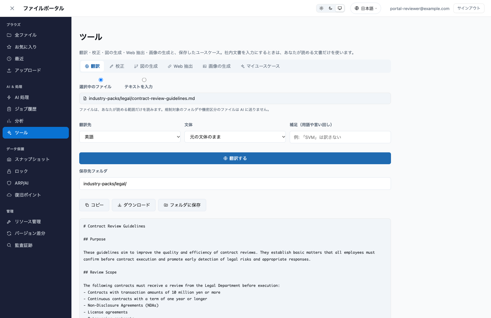
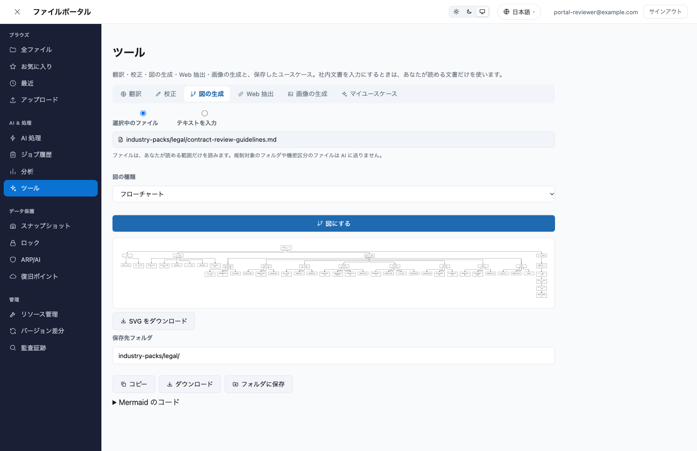
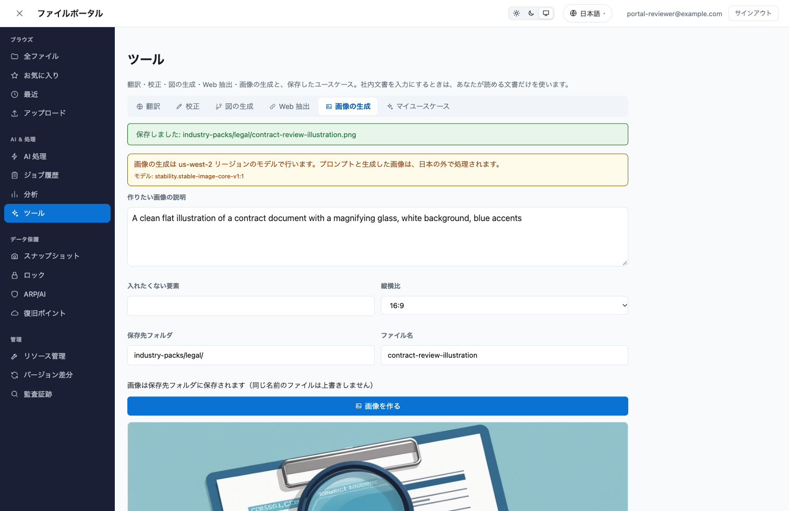
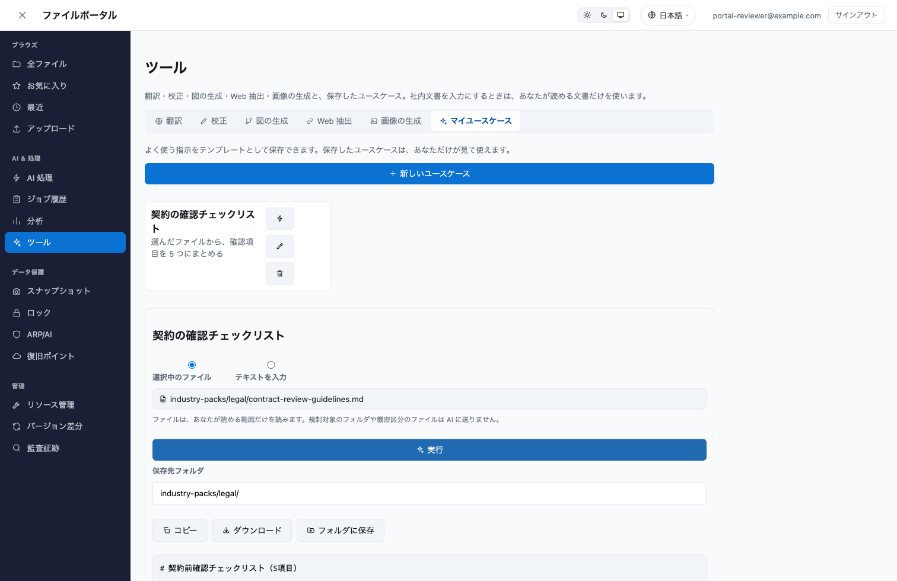

# ファイルポータルのツール

🌐 **Language / 言語**: 日本語 | [English](file-tools.en.md)

サイドバーの「ツール」で、FSx for ONTAP 上のファイルに対して翻訳・校正・図の生成をし、Web ページを要約し、画像を作ってフォルダに保存し、よく使う指示をテンプレートとして保存できます。ファイルの一覧でファイルを選ぶと、右の AI パネルに「翻訳・校正・図にする」のボタンが出て、そのファイルを入力にしてツールを開けます。スクリーンショットは、デプロイした Amplify sandbox（ap-northeast-1、2026-11-15）で撮りました。

## 各ツールの動作

| ツール | 入力 | 結果 |
|--------|------|------|
| 翻訳 | 選択中のファイル、または貼り付けたテキスト | 13 言語へ翻訳。文体と用語の補足を指定できる。結果はコピー、ダウンロード、フォルダへの保存（`<名前>.<言語>.md`） |
| 校正 | 同上 | 指摘（元の表記・修正案・理由）と、直した全文 |
| 図の生成 | 同上 | フローチャートなど 9 種類の図を Mermaid で描く。SVG のダウンロードと、`.mmd` のフォルダへの保存 |
| Web 抽出 | URL | 要約、本文の抽出、質問への回答 |
| 画像の生成 | プロンプト | 画像を作り、保存先フォルダに PNG で保存する。既定で無効 |
| マイユースケース | 選択中のファイル、またはテキスト | 保存したテンプレートの `{{input}}` に入力を入れて実行する |

## ファイルの読み書きと権限

- **ファイルを読むとき**: `functions/file-tools` は、ファイルの質問（`ask-about-file`）と同じ順で確かめます。外部の利用者の AI 利用、パスの境界（`scope_for_caller`）、規制対象のフォルダ（`/dicom/`、`/phi/`、`/pii/`）、データの機密区分の順です。境界の外のファイルは、何かを読む前に拒否します。読むのは先頭の 100 KB までです
- **書き込むとき**: フォルダへの保存（翻訳などの結果、画像）と、ユースケースの保存・削除は `toolsMutation` を通ります。ロールを強制しているときは、書き込みロール（contributor、storage-admin）だけが使えます。リゾルバーが `writeOperation` を設定するので、`toolsQuery` から書き込むことはできません。同じ名前のファイルは上書きせず、`-1` などを付けます
- **閲覧ロール**: 翻訳・校正・図の生成・Web 抽出と、保存済みのユースケースの実行はできます。ユースケースの作成と、フォルダへの保存はできません
- **Web 抽出**: ページは Lambda から取得します。公開されていないアドレス（プライベート、リンクローカル、メタデータの `169.254.169.254`、IPv6 のユニークローカル、IPv4 射影形式）に解決されるホスト、既定以外のポート、認証情報付きの URL は拒否します。接続は確かめたアドレスに固定し、リダイレクトは 1 段ごとに確かめ直します

## 設定

`amplify/portal-config.ts` の `tools`、または環境変数で決めます。既存の `portal-config.ts` に `tools` が無くても、環境変数が使われます。

| 環境変数 | 既定 | 内容 |
|----------|------|------|
| `AMPLIFY_PORTAL_IMAGE_GENERATION_ENABLED` | `false` | 画像の生成 |
| `AMPLIFY_PORTAL_IMAGE_GENERATION_REGION` | `us-west-2` | 画像のモデルを呼ぶリージョン |
| `AMPLIFY_PORTAL_IMAGE_GENERATION_MODEL_ID` | `stability.stable-image-core-v1:1` | 画像のモデル。推論プロファイル（`us.` など）も指定でき、IAM はそれに合わせて作られる |
| `AMPLIFY_PORTAL_WEB_EXTRACT_ENABLED` | `true` | Web 抽出 |

**[verified 2026-11-14 / ap-northeast-1、us-west-2 ほか 12 リージョン]** 東京リージョンには画像を出力するモデルがありません。 [E-019]テキストから画像を作るモデル（Stable Image Core / Ultra、SD3.5 Large）は、確かめた 14 リージョンのうち us-west-2 だけにあり、推論プロファイルはありません。このため既定は us-west-2 で、プロンプトと画像は日本の外で処理されます。画面にもそう表示します。テキストのツールは `jp.anthropic.claude-haiku-4-5-20251001-v1:0`（東京と大阪で処理）を使います。

## 確認結果

**[verified 2026-11-15 / ap-northeast-1]** Amplify sandbox で、storage-admin の利用者が `industry-packs/legal/` のファイルに対して確かめました。所要時間は 1 回ずつの観測値です。

| 確認したこと | 結果 |
|---|---|
| 選択中のファイルの英訳 | 6.7 秒。フォルダへの保存を 2 回行い、2 回目は上書きせず `contract-review-guidelines.md.en-1.md` になった |
| 図の生成（フローチャート） | 画面に描いた |
| 画像の生成（16:9） | 保存先フォルダに `contract-review-illustration.png` が保存され、ファイル一覧に出た |
| ユースケースの保存と、選択中のファイルでの実行 | 成功 |
| Web 抽出（公開ページ） | 4.8 秒 |
| Web 抽出のメタデータ URL | アプリ側で拒否（`the host resolves to an address that is not allowed`）。ポータルは AppSync 経由なので、手前に WAF はない |

**範囲**: 1 人の利用者（storage-admin）で確かめました。パスの境界、閲覧ロールの書き込み拒否、規制対象のフォルダの拒否は、`functions/file-tools/tests/` と `tests/components/FileTools.test.tsx` のテストで確かめていて、実機では確かめていません。

**この確認で見つかって直した不具合**: フォルダへの保存が 403 で失敗しました。Lambda のロールに `s3:ListBucket` が無いと、S3 は存在しないキーの HeadObject にも 404 ではなく 403 を返すため、「名前が空いている」と「拒否された」を区別できませんでした。ロールに `s3:ListBucket` を足して直しました。403 を「空いている」とみなす直し方は、拒否を見落とすので採っていません。

## 関連ドキュメント

| ドキュメント | 内容 |
|-------------|------|
| [業種別ユースケース](industry-use-cases.md) | AI 処理タブとエージェントのテンプレート |
| [UI コントリビューターガイド](CONTRIBUTING-UI.md) | 画面に機能を足す手順 |
