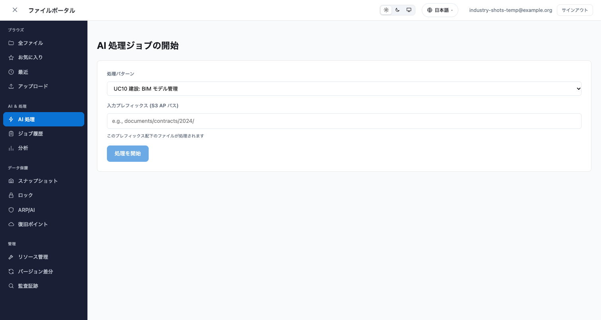
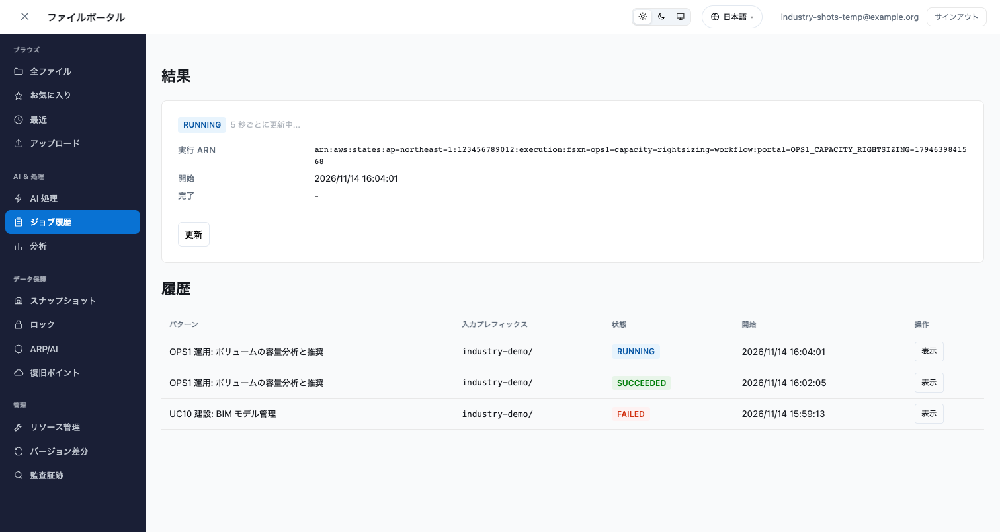
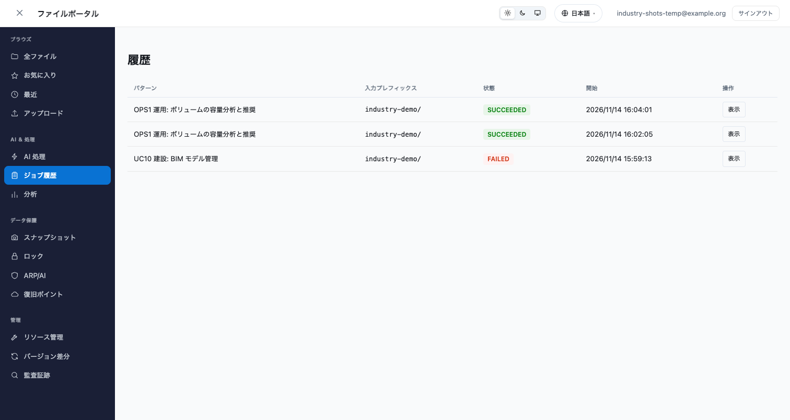
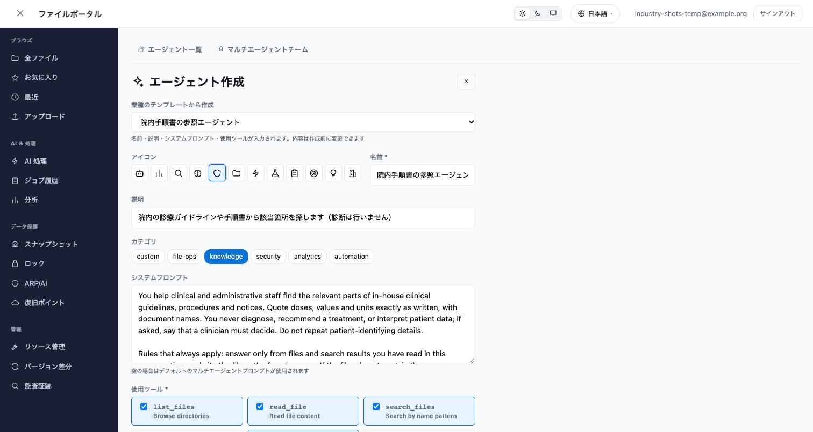
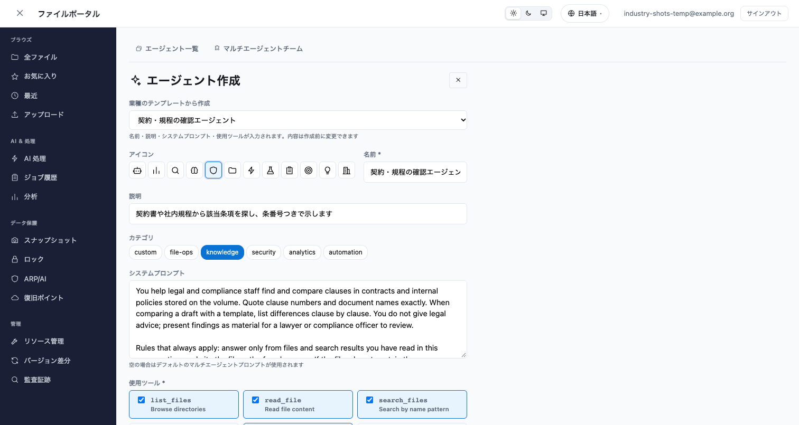
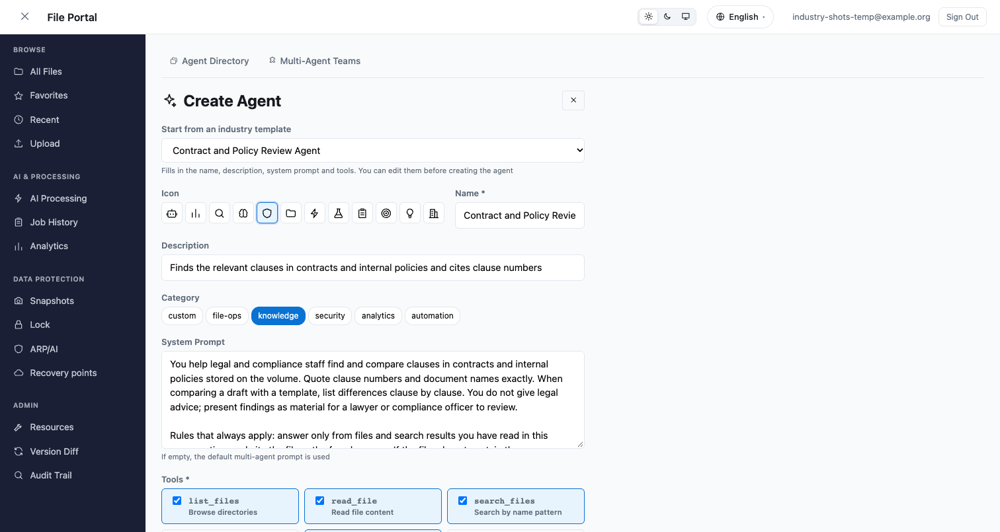

# Industry Use Cases in the File Portal

🌐 **Language / 言語**: [日本語](industry-use-cases.md) | English

The file portal's AI Processing tab and agent creator include industry use cases. The AI Processing tab starts the workflows of this repository's industry patterns (UC1 to UC28) and the operations pattern OPS1. The agent creator builds AI agents from industry templates. This page shows those screens and their behavior with screenshots taken on a deployed Amplify sandbox (ap-northeast-1, 2026-11-14).

## What this page covers

- The processing patterns in the AI Processing tab, and the setting that gives each pattern its own state machine
- What happens from starting a job until its state shows in the results and in the job history
- What the industry templates in the agent creator fill in

## Processing pattern list

The list shows the number, industry and task of each pattern in the selected language. UC1 to UC28 use the same numbers as the industry pattern table in the repository README. FC7 (restore from a FlexClone) is started from the Snapshots screen, so it is not in this list.




## One state machine per pattern

Which state machine a pattern starts is set per pattern name in `stateMachineArns` in `amplify/portal-config.ts`. A pattern that is not listed starts the single `stateMachineArn`, as before.

```typescript
stateMachineArns: {
  UC10_CONSTRUCTION_BIM: "arn:aws:states:ap-northeast-1:<account>:stateMachine:<UC10 state machine name>",
  OPS1_CAPACITY_RIGHTSIZING: "arn:aws:states:ap-northeast-1:<account>:stateMachine:<OPS1 state machine name>",
},
```

Look up the ARNs with `aws stepfunctions list-state-machines` after deploying the patterns. They cannot be derived from a naming rule: deployed stacks use both `fsxn-uc10-construction-bim` and `fsxn-construction-bim`, and UC28 is shortened to `fsxn-chemical-sds`.

Each entry becomes an AppSync environment variable `SFN_ARN_<number>` (for example `SFN_ARN_UC10`). AppSync allows up to 50 environment variables per API, each value up to 512 characters ([PutGraphqlApiEnvironmentVariables](https://docs.aws.amazon.com/appsync/latest/APIReference/API_PutGraphqlApiEnvironmentVariables.html)). The Step Functions input also carries `pattern`, so a single state machine can branch by pattern instead.

## Starting a job and its result

This screen shows OPS1 (volume capacity analysis and recommendations) after it was started. Starting a job switches to the results screen, which reads the state again every 5 seconds until the execution ends. This execution reached SUCCEEDED in 2 seconds.



## Job history

The job history shows each pattern by industry and task. A row is written as RUNNING when the job starts. When the job history opens, the rows that still say RUNNING are checked with Step Functions, and the final state is stored for the ones that have ended.



The UC10 row is FAILED because of the UC10 stack. The UC10 workflow's Lambda was denied ListObjectsV2 on its own stack's S3 Access Point. The execution history shows that the start from the portal reached the UC10 state machine with `pattern` in its input.

## Creating an agent from an industry template

Choosing a template under "Start from an industry template" in the agent creator fills in the name, description, system prompt, tools and category. Every field can be changed before the agent is created, and the result is an ordinary custom agent. There are 16 templates (contracts and policies, financial documents, quality and maintenance, clinical procedures, claims, ordinances and notices, construction records, education and research, HR policies, property and leases, logistics, telecom incidents, retail, traceability, lab and safety data, ESG and grants).

The healthcare template's system prompt states that the agent does not diagnose or decide on treatment.




The legal template's system prompt states that findings are material for review, not legal advice.





The system prompts are in English only. The shared part tells the agent to answer in the language the user writes in.

## Retaking the screenshots

After a screen change, retake them with the command below. `--allow-start` really starts OPS1; without it the started-job shot is not taken.

```bash
cd solutions/amplify-portal
PORTAL_USER=... PORTAL_PASSWORD=... node scripts/capture-screenshots.mjs \
  --base http://localhost:5173 --set industry --allow-start
```

Before each capture, account IDs, IP addresses and similar values in the page text are replaced, and the text is checked again afterwards. An image with any of them left is not saved.

## What was checked

- Checked: deployment to the Amplify sandbox, the AppSync environment variables (4), routing to the UC10 and OPS1 state machines, a successful OPS1 run, the job history state update, and the template fill in the agent creator
- Not checked: a successful run of any UC other than UC10 (UC10 failed on its stack's permissions), a conversation with an agent created from a template, and screens in languages other than Japanese and English

## Related documents

- [Portal tabs guide](portal-tabs-guide.en.md)
- [UI contributor guide](CONTRIBUTING-UI.en.md) (steps for adding a processing pattern)
- [Step Functions × AgentCore Gateway pattern](../../genai/stepfunctions-agentcore-tools/README.en.md) (starting a workflow from an agent with an industry)
