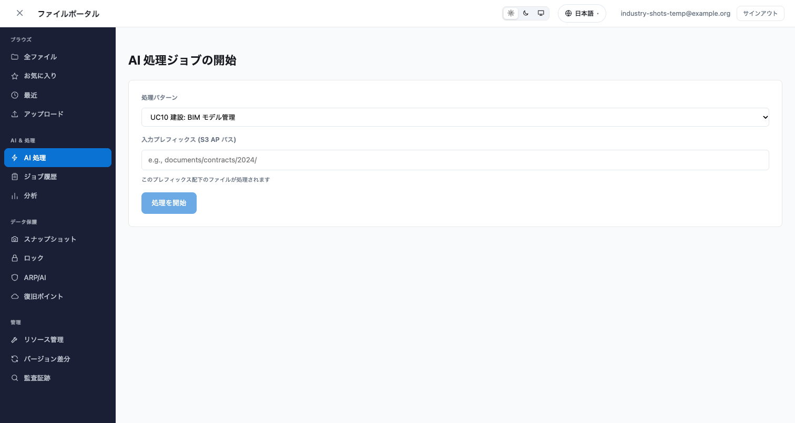
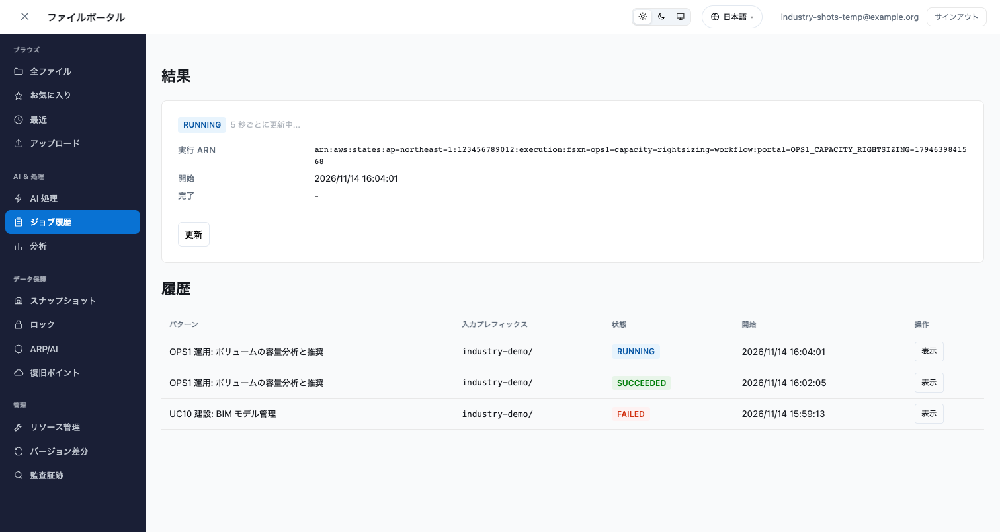
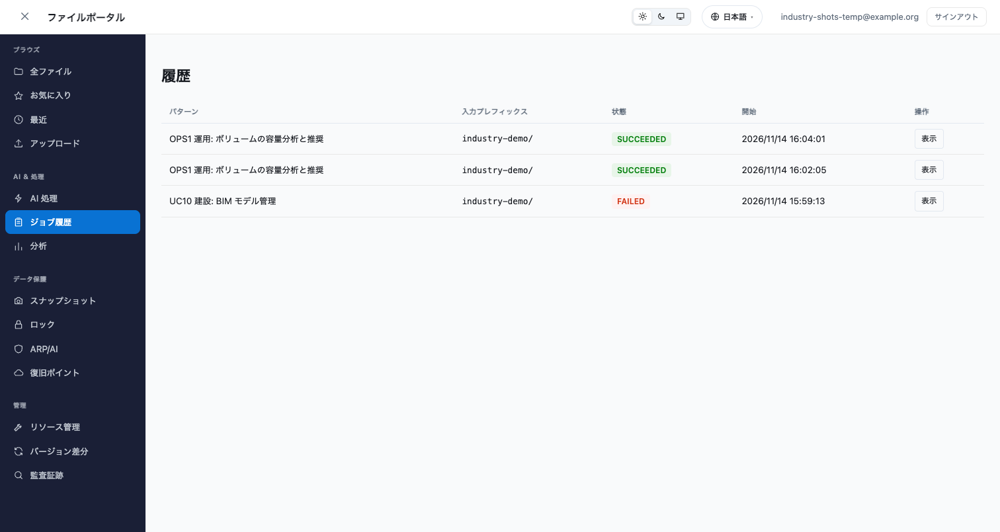
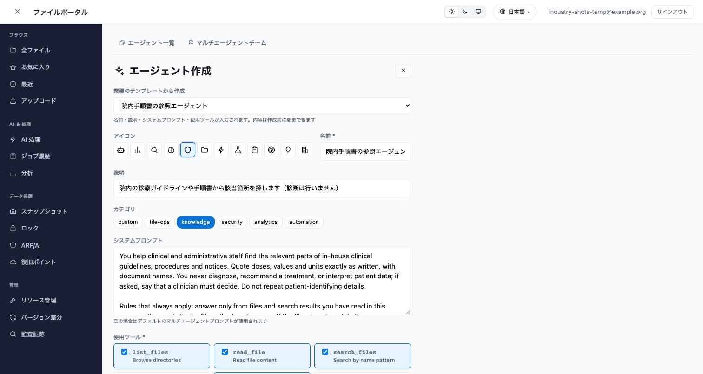
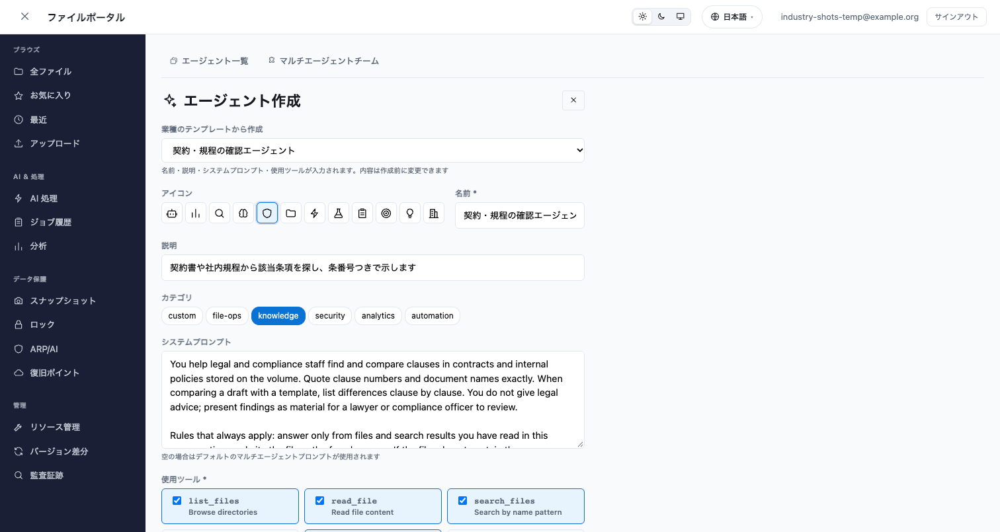
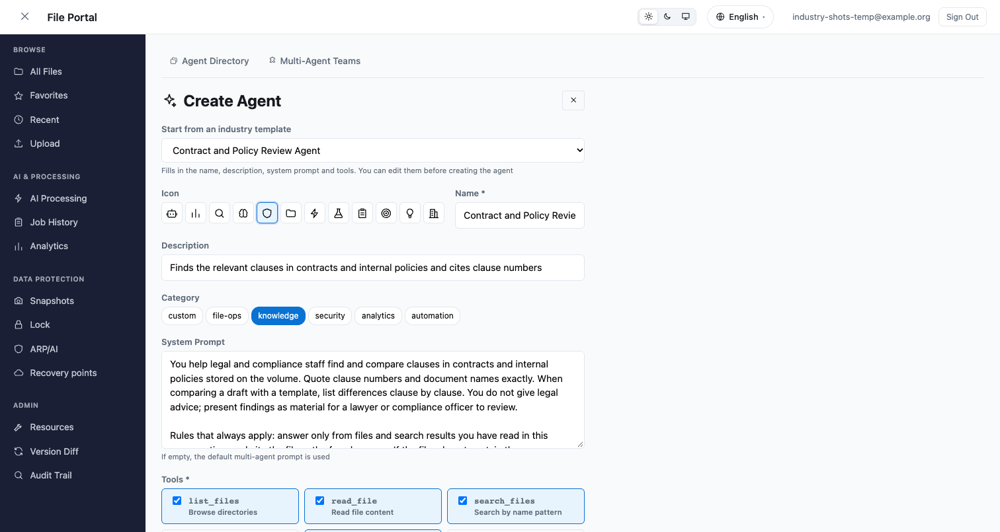

# ファイルポータルの業種別ユースケース

🌐 **Language / 言語**: 日本語 | [English](industry-use-cases.en.md)

ファイルポータルの AI 処理タブとエージェント作成画面には、業種別のユースケースがあります。AI 処理タブでは、このリポジトリの業種別パターン（UC1 から UC28）と運用パターン OPS1 のワークフローを起動できます。エージェント作成画面では、業種別のテンプレートから AI エージェントを作れます。このページは、その画面と動作を、デプロイした Amplify sandbox（ap-northeast-1、2026-11-14）で撮ったスクリーンショットで示します。

## このページで分かること

- AI 処理タブで選べる処理パターンと、パターンごとにステートマシンを分ける設定
- ジョブを起動してから、結果とジョブ履歴に状態が出るまで
- エージェント作成画面の業種テンプレートで、何が入力されるか

## 処理パターンの一覧

処理パターンの一覧は、番号・業種・処理内容を、選択中の言語で表示します。UC1 から UC28 は、リポジトリの README の業種別パターンの表と同じ番号です。FC7（FlexClone からの復元）は、スナップショットの画面から起動するので、この一覧には出しません。




## パターンごとのステートマシンの設定

どのステートマシンを起動するかは、`amplify/portal-config.ts` の `stateMachineArns` にパターン名ごとに書きます。書いていないパターンは、従来どおり `stateMachineArn` の 1 本を起動します。

```typescript
stateMachineArns: {
  UC10_CONSTRUCTION_BIM: "arn:aws:states:ap-northeast-1:<account>:stateMachine:<UC10 のステートマシン名>",
  OPS1_CAPACITY_RIGHTSIZING: "arn:aws:states:ap-northeast-1:<account>:stateMachine:<OPS1 のステートマシン名>",
},
```

ARN は、パターンをデプロイしたあとに `aws stepfunctions list-state-machines` で調べます。名前の規則からは導けません。デプロイ済みのスタックの名前には `fsxn-uc10-construction-bim` と `fsxn-construction-bim` の両方の形があり、UC28 は `fsxn-chemical-sds` のように短くなっているためです。

各エントリは、AppSync の環境変数 `SFN_ARN_<番号>`（`SFN_ARN_UC10` など）になります。AppSync の環境変数は 1 つの API に 50 個まで、値は 512 文字までです（[PutGraphqlApiEnvironmentVariables](https://docs.aws.amazon.com/appsync/latest/APIReference/API_PutGraphqlApiEnvironmentVariables.html)）。Step Functions の入力には `pattern` も入るので、1 本のステートマシンでパターンごとに分岐させることもできます。

## ジョブの起動と結果

OPS1（ボリュームの容量分析と推奨）を起動した画面です。起動すると結果の画面に切り替わり、実行が終わるまで 5 秒ごとに状態を読み直します。この実行は 2 秒で SUCCEEDED になりました。



## ジョブ履歴

ジョブ履歴は、パターンを業種と処理内容で表示します。履歴の行は起動したときに RUNNING で書かれます。ジョブ履歴を開いたときに、まだ RUNNING の行だけ Step Functions に状態を問い合わせ、終わっていれば最終の状態を保存します。



UC10 の行が FAILED なのは、UC10 のスタック側の問題です。UC10 のワークフローの Lambda が、自分のスタックの S3 Access Point に対する ListObjectsV2 を拒否されました。ポータルからの起動は UC10 のステートマシンに届いており、入力に `pattern` が入っていることも実行履歴で確認しています。

## 業種テンプレートからのエージェント作成

エージェント作成画面の「業種のテンプレートから作成」でテンプレートを選ぶと、名前・説明・システムプロンプト・使用ツール・カテゴリが入ります。どれも作成前に変更でき、作られるエージェントは通常のカスタムエージェントです。テンプレートは 16 種類あります（契約と規程、帳票、品質と保全、院内手順書、保険査定、条例と通達、工事記録、教育と研究、人事規程、物件と賃貸借、物流、通信の障害記録、小売、トレーサビリティ、実験と安全データ、ESG と助成金）。

医療のテンプレートは、診断や治療方針の判断をしないことをシステムプロンプトに含めます。




法務のテンプレートは、法的助言ではなく確認の材料として示すことをシステムプロンプトに含めます。





システムプロンプトは英語だけです。共通部分で、利用者が書いた言語で答えるように指示しています。

## スクリーンショットの撮り直し

画面を変えたら、次のコマンドで撮り直します。`--allow-start` を付けると OPS1 を実際に起動するので、付けなければ起動の画面は撮りません。

```bash
cd solutions/amplify-portal
PORTAL_USER=... PORTAL_PASSWORD=... node scripts/capture-screenshots.mjs \
  --base http://localhost:5173 --set industry --allow-start
```

撮影の前に、画面の文字からアカウント ID や IP アドレスなどを置き換え、置き換え後に残っていないかを検査します。残っていた画像は保存しません。

## 確認した範囲

- 確認したこと: Amplify sandbox へのデプロイ、AppSync の環境変数への反映（4 個）、UC10 と OPS1 のステートマシンへの振り分け、OPS1 の成功、ジョブ履歴の状態の更新、エージェント作成画面のテンプレートの入力
- 確認していないこと: UC10 以外の UC の実行の成功（UC10 はスタック側の権限で失敗）、テンプレートから作ったエージェントとの会話、英語と日本語以外の画面

## 関連ドキュメント

- [ポータルのタブガイド](portal-tabs-guide.md)
- [UI コントリビューターガイド](CONTRIBUTING-UI.md)（処理パターンを追加するときの手順）
- [Step Functions × AgentCore Gateway のパターン](../../genai/stepfunctions-agentcore-tools/README.md)（エージェントから業種を指定してワークフローを起動する）
